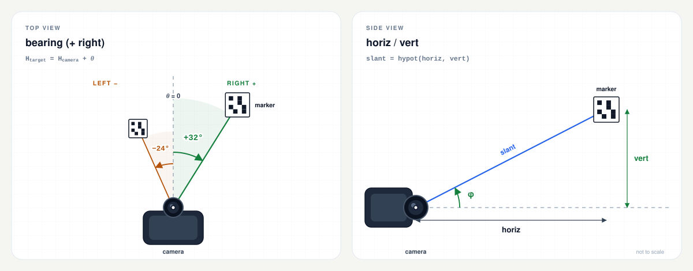

# arucocam

[English](README.md) | [繁體中文](README.zh-TW.md) | [简体中文](README.zh-CN.md) | [Español](README.es.md) | [Русский](README.ru.md)

> Esta es una traducción del [README en inglés](README.md); si hay discrepancias, prevalece la versión en inglés.

Un único binario estático que detecta marcadores ArUco e informa la demora
(bearing), la distancia horizontal y el desplazamiento vertical de cada marcador.
Está pensado para robots Raspberry Pi y otros sistemas Linux: no se necesita
OpenCV, Python ni ningún archivo de configuración en el dispositivo.

```bash
$ arucocam --preset cm3-1280 --device /dev/video0 --json
```

```json
{
  "7": {
    "bearing": 22.6,
    "horiz": 1.23,
    "vert": -0.02
  }
}
```

El ejemplo está formateado con sangrías para mostrar la estructura. Con
`--json`, la salida real es JSON Lines: un objeto compacto por cada fotograma
procesado, un objeto por línea. Cada marcador se identifica por su ID:

- `bearing` es el ángulo hacia el marcador respecto al eje frontal de la
  cámara, en grados (positivo a la derecha, negativo a la izquierda).
- `horiz` es la distancia plana al marcador en metros, medida en el plano
  horizontal de la cámara.
- `vert` es el desplazamiento vertical en metros (positivo hacia arriba,
  negativo hacia abajo).

La distancia 3D es `hypot(horiz, vert)`. Consulta [Salida](#salida) para ver el
contrato completo, incluida la salida de texto y la precisión.

[](docs/README.md)

## Contenido

- [Inicio rápido](#inicio-rápido)
- [Características](#características)
- [Plataformas compatibles](#plataformas-compatibles)
- [Marcadores](#marcadores)
- [Calibración](#calibración)
- [Entrada de cámara](#entrada-de-cámara)
- [Salida](#salida)
- [Opciones](#opciones)
- [Solución de problemas](#solución-de-problemas)
- [Compilación](#compilación)
- [Pruebas](#pruebas)
- [Verificación de las versiones](#verificación-de-las-versiones)
- [Licencia](#licencia)
- [Estructura del repositorio](#estructura-del-repositorio)

## Inicio rápido

### 1. Elegir el binario

| Dispositivo / SO | `uname -m` | Archivo de la versión |
| --- | --- | --- |
| Pi Zero, Zero W, Pi 1 (SO de 32 bits) | `armv6l` | `arucocam-arm32` |
| Pi 3, Pi 4, Pi 5, Zero 2 W, CM4/CM5 (SO de 64 bits) | `aarch64` | `arucocam-arm64` |
| Pi posteriores con SO de 32 bits | `armv7l` | `arucocam-arm32` |
| Linux x86-64 | `x86_64` | `arucocam-amd64` |

Descárgalo desde la [última versión](https://github.com/fernjager/arucocam/releases/latest)
y hazlo ejecutable:

```bash
ASSET=arucocam-arm64
BASE=https://github.com/fernjager/arucocam/releases/latest/download
wget -O arucocam "$BASE/$ASSET"
chmod +x arucocam
```

Cambia `ASSET` según tu plataforma. Así se guarda el archivo de la versión como
`arucocam`. Para instalarlo más adelante en todo el sistema, ejecuta
`sudo install -m 0755 arucocam /usr/local/bin/arucocam`.

`wget` suele estar disponible en Raspberry Pi OS y en sistemas
mínimos/BusyBox. Si no está, o si no dispone de compatibilidad con HTTPS, usa
`curl -fLo arucocam "$BASE/$ASSET"` en su lugar. Para verificar
primero la descarga, consulta [Verificación de las versiones](#verificación-de-las-versiones).

### 2. Comprobar que funciona

```bash
./arucocam --version
./arucocam --list-presets
```

`--list-presets` imprime los parámetros intrínsecos y el campo de visión
horizontal de cada módulo compatible. Elige el preset más parecido a tu cámara.

### 3. Apuntar a un marcador

```bash
# A V4L2 capture device:
./arucocam --preset v2-640 --device /dev/video0 --json

# A libcamera/rpicam producer:
rpicam-vid -t 0 --codec yuv420 --width 640 --height 480 --framerate 15 --inline -o - |
  ./arucocam --preset v2-640 --stdin --json
```

Imprime un marcador del mismo diccionario (el predeterminado es `DICT_4X4_50`)
y asigna a `--marker-size` el ancho medido del cuadrado negro en milímetros. El
valor predeterminado es 100 mm. Consulta [Marcadores](#marcadores).

Si `/dev/video0` no es tu cámara, o si tu cámara solo está expuesta a través de
libcamera, consulta [Entrada de cámara](#entrada-de-cámara).

El resto de este README escribe `arucocam` como si estuviera en el `PATH`.
Mientras ejecutes el binario descargado desde este directorio, usa
`./arucocam`.

## Características

- [Ajustes de calibración predefinidos](#presets) para los módulos de cámara
  habituales de Raspberry Pi y Arducam a 640x480, 1280x720 y 1920x1080.
- Sin archivos de configuración: todos los parámetros se pueden establecer en la
  línea de comandos.
- No se necesita OpenCV ni un entorno de ejecución de Python en el destino. Los
  binarios están enlazados estáticamente con musl.
- Captura V4L2, flujos por stdin (I420, MJPEG o gris sin procesar) e imágenes
  fijas individuales.
- JSON Lines compacto para controladores, además de texto legible por humanos y
  diagnósticos con `--detect-only`.
- Compilación para ARMv6 fijada a VFPv2 y comprobada para garantizar la ausencia
  de NEON, de modo que funciona en Pi Zero y Pi 1, así como en versiones
  posteriores de Raspberry Pi OS de 32 bits.

## Plataformas compatibles

| Plataforma | Placas / sistemas | Binario | Compilación |
| --- | --- | --- | --- |
| `armv6` | Pi Zero, Pi Zero W, Pi 1 | `dist/arucocam-arm32` | ARM1176JZF-S, VFPv2, **sin NEON** |
| `arm64` | Pi 3, Pi 4, Pi 5, Zero 2 W, CM4/CM5 | `dist/arucocam-arm64` | ARMv8-A AArch64 |
| `amd64` | Linux x86-64 | `dist/arucocam-amd64` | x86-64 genérico, base SSE2 |

Los tres binarios son ejecutables ELF de Linux, enlazados estáticamente con
musl. Funcionan en distribuciones con glibc y musl sin OpenCV instalado. El
binario ARMv6 también funciona en versiones posteriores de Raspberry Pi OS de
32 bits; un binario armhf normal puede enlazar y luego fallar en el ARM1176
porque contiene instrucciones NEON.

La captura V4L2 directa necesita Linux y un dispositivo de captura V4L2. En
Raspberry Pi OS moderno, la pila de cámara es libcamera, por lo que la ruta por
stdin suele ser la forma más sencilla de usar una cámara de Pi. Consulta
[Entrada de cámara](#entrada-de-cámara).

## Marcadores

`arucocam` detecta marcadores ArUco. Las reglas prácticas son:

- **Diccionario.** El marcador impreso y `--dict` deben usar el mismo
  diccionario. El valor predeterminado es `DICT_4X4_50`. Los nombres de los
  diccionarios no distinguen mayúsculas de minúsculas.
- **ID.** El ID está codificado en el marcador. Usa `--target-id 7` para
  informar solo del marcador 7; sin esa opción, se procesa cada marcador que
  supere el filtro de pose.
- **Tamaño.** `--marker-size` es la longitud del lado del cuadrado negro
  exterior en milímetros. No es el tamaño del papel, el tamaño de la imagen ni
  la zona de silencio blanca. El valor predeterminado es 100 mm.
- **Zona de silencio.** Mantén un borde blanco alrededor del marcador. Los
  marcadores generados con el valor predeterminado `borderBits=1` de OpenCV
  incluyen un módulo de borde.
- **Impresión.** Imprime al 100 % / tamaño real y mide el cuadrado negro con un
  calibre. Un error de 1 mm en un marcador de 100 mm supone un sesgo de
  distancia del 1 %.
- **Montaje.** Mantén el marcador plano, rígido, mate e iluminado de forma
  uniforme. Los reflejos, las arrugas y el desenfoque de movimiento degradan la
  pose. El detector no informa la orientación del marcador, solo su posición.

Para generar un marcador en un equipo de trabajo (no se necesita OpenCV Python
en el destino):

```python
import cv2

dictionary = cv2.aruco.getPredefinedDictionary(cv2.aruco.DICT_4X4_50)
marker = cv2.aruco.generateImageMarker(dictionary, 7, 800)
cv2.imwrite("marker-7.png", marker)
```

Imprime `marker-7.png` a tamaño real. La imagen de 800x800 incluye el borde
blanco; para `--marker-size`, mide el cuadrado negro, que es más pequeño que la
imagen.

El auxiliar de pruebas `tests/gen_marker.cpp` también puede dibujar un marcador
en un lienzo PGM, pero solo se compila con el conjunto de pruebas y no se
instala.

## Calibración

Usa un preset:

```bash
arucocam --preset fisheye160-640 --device /dev/video0 --json
```

O pasa los parámetros intrínsecos directamente:

```bash
arucocam --fx 600 --fy 600 --cx 320 --cy 240 \
         --width 640 --height 480 --marker-size 100 --device /dev/video0 --json
```

- `--fx/--fy` son obligatorios a menos que se use `--preset`.
- `--cx/--cy` toman por defecto el centro de la imagen.
- `--k1..--k4` son los coeficientes de distorsión de ojo de pez; por defecto
  `0`.
- `--preset` no se puede combinar con `--fx/--fy/--cx/--cy/--k1..--k4` ni con
  `--width/--height`.
- Un preset establece `--width`, `--height`, `--fx`, `--fy`, `--cx` y `--cy`, y
  pone los coeficientes de distorsión a cero. **No** establece
  `--marker-size`.
- `--marker-size` es el **cuadrado negro exterior** en milímetros, no el tamaño
  del papel ni el de la zona de silencio. Valor predeterminado `100`.
- Captura y calibra con la misma relación de aspecto; lo más sencillo es usar la
  misma resolución. Si el fotograma tiene un tamaño distinto pero una relación
  de aspecto coincidente (con un margen del 0,5 %), los parámetros intrínsecos
  se escalan al fotograma; de lo contrario, el programa termina con un error de
  relación de aspecto no coincidente.

Un preset es un punto de partida, no una calibración. Para obtener distancia
métrica, calibra `fx`, `fy`, `cx`, `cy` y la distorsión con
`cv::fisheye::calibrate` o una herramienta de tablero de ajedrez. Enfoca la
cámara antes de calibrar y bloquea el autofoco si el módulo lo permite.

### Presets

Los nombres están en minúsculas y distinguen mayúsculas de minúsculas, con el
formato `<family>-<resolution>`: `-640` es 640x480, `-1280` es 1280x720 y
`-1920` es 1920x1080. Ejecuta `arucocam --list-presets` para imprimir estos
valores y el FOV horizontal en forma de tabla.

| Familia | Módulo / óptica | FOV horizontal | fx=fy a 640 / 1280 / 1920 | Marcador de 100 mm en px a 1 m / 3 m |
| --- | --- | ---: | ---: | ---: |
| `v1` | Módulo de cámara V1 / NoIR / cámara de Pi Zero (OV5647, 3,6 mm) | 53,5° | 635 / 1270 / 1905 | 64 / 21 |
| `v2` | Módulo de cámara V2 / NoIR (IMX219, 3,04 mm) | 62,2° | 530 / 1061 / 1591 | 53 / 18 |
| `cm3` | Módulo de cámara 3 (IMX708, 4,74 mm) | 66° | 493 / 985 / 1478 | 49 / 16 |
| `cm3wide` | Módulo de cámara 3 Wide (IMX708, 2,75 mm) | 102° | 259 / 518 / 777 | 26 / 9 |
| `aicam` | Cámara AI (IMX500, 4,74 mm) | 66,3° | 490 / 980 / 1470 | 49 / 16 |
| `imx519` | Arducam 16MP IMX519 con autofoco, objetivo de serie | 66° | 493 / 985 / 1478 | 49 / 16 |
| `hawkeye` | Arducam 64MP Hawk-Eye con autofoco, objetivo de serie (OV64A40) | 72° | 440 / 881 / 1321 | 44 / 15 |
| `owlsight` | Arducam 64MP OwlSight, objetivo de 6,65 mm (OV64A40) | 68° | 474 / 949 / 1423 | 47 / 16 |
| `fisheye160` | Ojo de pez OV5647 de 160° en diagonal | 160° diag. (≈128° H) | 286 / 573 / 860 | 29 / 10 |

Nombres completos: `v1-640`, `v1-1280`, `v1-1920`, y lo mismo para las demás
familias. El FOV horizontal es el mismo en las tres resoluciones porque depende
del objetivo.

Las filas de Arducam suponen el objetivo de serie indicado; un objetivo distinto
cambia `fx`. Trátalas como puntos de partida, no como calibraciones. Las
variantes NoIR usan el mismo preset que la versión en color.

La columna del ancho del marcador usa el preset de 640 px y un cuadrado negro de
100 mm. A 1280 y 1920, el marcador es aproximadamente el doble y el triple de
ancho, respectivamente, a menos que `--process-width` devuelva el procesamiento
a 640.

Notas:

- 160° es el FOV **diagonal** del ojo de pez. Los presets 16:9 recortan
  verticalmente el sensor 4:3, por lo que su FOV diagonal se aproxima más a
  147°.
- Los presets `cm3-640` y `cm3wide-640` son aproximados porque esos sensores son
  16:9; en un Pi Zero, es preferible usar 1280x720 con `--process-width 640`.
- La HQ Camera y la Global Shutter Camera tienen objetivos C/CS; no hay un
  preset universal. Usa `--fx/--fy` o calibra.

Si un preset se aleja mucho, calibra en lugar de ajustar `fx` a ojo.

## Entrada de cámara

Elige exactamente un origen. `--image`, `--stdin` y `--device` son mutuamente
excluyentes; si no se indica ninguno, el programa abre `/dev/video0` a través de
V4L2.

| Origen | Úsalo para | Notas |
| --- | --- | --- |
| `--image PATH` | Un solo fotograma fijo | PGM, PNG o JPEG; termina después de un fotograma |
| `--device PATH` | Captura V4L2 en Linux | `/dev/video0` por defecto; debe exponer un formato compatible |
| `--stdin` | libcamera/rpicam, GStreamer u otro proceso | I420/gris sin procesar o MJPEG; ajusta `--width/--height` al tamaño de fotograma del productor |

### Cámara V4L2

```bash
arucocam --preset fisheye160-640 --device /dev/video0 --json
arucocam --preset fisheye160-1280 --process-width 640 \
         --device /dev/video0 --max-fps 10 --json
```

`--device` usa `/dev/video0` de forma predeterminada. Encuentra los nodos de
captura con:

```bash
sudo apt install v4l-utils
v4l2-ctl --list-devices
```

La ruta V4L2 prefiere los formatos de luminancia directa: `GREY`, `YUV420`,
`NV12`, `YUYV`, `UYVY`, después `MJPEG`/`JPEG` y luego `RGB24`/`BGR24`. YUYV es
lo que suele ofrecer el controlador `bcm2835-v4l2` de la Pi. El programa solicita
el tamaño indicado por `--width`/`--height` y falla si el controlador no puede
proporcionar un formato compatible con ese tamaño.

`--max-fps` limita el **procesamiento** y descarta los fotogramas obsoletos; usa
`--max-fps 5` cuando la CPU esté al máximo. El programa no ajusta la velocidad de
fotogramas de la cámara ni modifica sus controles: la exposición, la
ganancia/ISO, el balance de blancos y la velocidad de fotogramas permanecen tal
como los dejaron `v4l2-ctl` o el controlador. Algunos controladores restablecen
los controles al cambiar de formato, así que verifícalos mientras el programa se
está ejecutando.

Si la cámara solo expone H.264 u otro formato no compatible, o si solo está
disponible a través de libcamera, usa la ruta por stdin con un productor que
emita I420 o MJPEG (por ejemplo, `rpicam-vid --codec yuv420`).

### Entrada estándar (stdin)

```bash
rpicam-vid -t 0 --codec yuv420 --width 640 --height 480 --framerate 15 --inline -o - |
  arucocam --preset fisheye160-640 --stdin --json
```

`rpicam-vid` es el nombre en Bookworm; las imágenes Bullseye más antiguas usan
`libcamera-vid`. `--codec yuv420` genera I420 sin procesar. Para MJPEG:

```bash
rpicam-vid -t 0 --codec mjpeg --width 1280 --height 720 --framerate 30 --inline -o - |
  arucocam --preset v2-1280 --stdin --stdin-format mjpeg --json
```

`--stdin-format` se establece en `auto` de forma predeterminada: el programa
examina los dos primeros bytes, interpreta un inicio de imagen JPEG como MJPEG y
cualquier otra cosa como I420 sin procesar. Usa `--stdin-format gray` para escala
de grises de 8 bits sin procesar, o `mjpeg` si un productor emite JPEG. Los alias
aceptados son `jpeg` para `mjpeg`, `yuv420`/`yuv` para `i420` y `grey`/`raw` para
`gray`.

Los formatos sin procesar requieren `--width` y `--height`; I420 además exige que
ambos sean pares. Ajusta `--width/--height` al tamaño de fotograma del productor
para cualquier origen por stdin: MJPEG puede decodificar sus propias dimensiones,
pero las opciones siguen definiendo la geometría de calibración. Una
discrepancia puede desincronizar los fotogramas sin procesar o provocar un error
de relación de aspecto.

`--frames N` es útil para una prueba rápida, y `--max-fps` limita el
procesamiento sin cambiar la velocidad de fotogramas del productor. Hay un
registro de salida por cada fotograma decodificado; no se adjunta ninguna marca
de tiempo.

### Imagen fija

```bash
arucocam --preset fisheye160-640 --image frame.pgm --json
arucocam --preset fisheye160-640 --detect-only --image frame.pgm
```

`--image` acepta PGM, PNG o JPEG y procesa un solo fotograma. Una imagen fija usa
`--confirm 1` de forma predeterminada, a menos que se indique `--confirm`
explícitamente. No pases un `--confirm` mayor que 1 con una sola imagen: el
marcador nunca podrá acumular suficientes fotogramas consecutivos para
confirmarse en la salida **JSON** (la salida de texto imprime una pose válida de
inmediato).

La imagen debe coincidir con la relación de aspecto de la calibración (lo más
sencillo es usar la resolución exacta). Si no coincide, el programa informa de
una discrepancia de relación de aspecto; usa un preset que coincida o pasa los
`--width`/`--height` y los parámetros intrínsecos de la imagen.

## Salida

### JSON

`--json` emite JSON Lines: un objeto compacto por cada fotograma procesado,
seguido de un salto de línea y vaciado de inmediato. No hay un array contenedor
ni una marca de tiempo.

```json
{"7":{"bearing":2.6,"horiz":1.23,"vert":-0.02},"8":{"bearing":-11.4,"horiz":0.82,"vert":0.03}}
```

- Las claves son los ID de los marcadores como cadenas JSON, ordenadas de forma
  ascendente.
- Solo se incluyen los marcadores **confirmados** que tienen una pose válida.
- Sin marcadores: `{}` (o `{"_timing":{...}}` con `--timing`).
- Varios marcadores: una clave por marcador.
- No se emite ninguna marca de tiempo; márcala al recibirla en el controlador.
  No hay registros de objetivo, depuración ni pose completa.
- `--target-id N` filtra la salida; la detección se sigue ejecutando para todos
  los marcadores.
- `_timing` es una clave reservada y solo está presente con `--timing`.

| Campo | Unidad | Significado |
| --- | --- | --- |
| `bearing` | grados | Positivo a la derecha (en sentido horario), −180 a 180 |
| `horiz` | metros | Distancia plana en el plano horizontal de la cámara |
| `vert` | metros | Desplazamiento vertical, positivo hacia arriba, relativo a la cámara |

Sistema de referencia del cuerpo: `x` hacia delante, `y` hacia la izquierda, `z`
hacia arriba. El origen es el centro óptico de la cámara. `bearing = 0` es el eje
frontal, normalmente el centro de la imagen; un punto principal calibrado puede
estar ligeramente fuera del centro.

La demora informada sigue el estilo de una brújula, no el ángulo polar del sistema
de referencia del cuerpo. Reconstruye la posición del marcador con:

```text
x       = horiz * cos(bearing)
y_left  = -horiz * sin(bearing)
z       = vert
```

Si el eje frontal de la cámara tiene un rumbo de brújula `H_camera`, la demora
absoluta del marcador es:

```text
H_target = H_camera + bearing
```

`vert` no es la altura sobre el suelo; es el desplazamiento vertical del marcador
respecto a la cámara. La distancia 3D real es `hypot(horiz, vert)`.

Diagramas completos: [vista superior](docs/bearing-top-view.svg) ·
[vista lateral](docs/bearing-side-view.svg) ·
[notas de geometría](docs/README.md).

`--timing` añade una clave reservada `_timing` a cada línea JSON:

```json
{"7":{"bearing":2.6,"horiz":1.23,"vert":-0.02},"_timing":{"processMs":12.345}}
```

`processMs` es el tiempo dedicado a la detección/PnP de ese fotograma, sin contar
la salida JSON ni la pausa de `--max-fps`. Solo afecta a JSON cuando se solicita
explícitamente. `--timing` requiere `--json`.

Hay un transporte binario compacto reservado para una versión futura; **no** está
implementado. Los nombres de los campos JSON y sus unidades son la interfaz
estable por ahora. El diseño previsto está en
[docs/binary-protocol.md](docs/binary-protocol.md).

### Salida de texto

Sin `--json`, la salida es legible por humanos:

```text
id=7 bearing=+2.6deg horiz=1.23m vert=-0.02m
```

Añade `--verbose` para ver el RMS y el área en píxeles:

```text
id=7 bearing=+2.6deg horiz=1.23m vert=-0.02m rms=0.42px area=4096px
```

JSON espera `--confirm` fotogramas válidos consecutivos. La salida de texto es un
flujo de diagnóstico: imprime un marcador con pose válida de inmediato, incluso
antes de que se confirme, por lo que `--confirm` no retrasa la salida de texto.
Si un marcador se detecta pero no supera el filtro de pose, la salida de texto lo
informa; JSON no:

```text
id=7 detected center=(320.0,240.0) area=1200px rejected rms=8.20px
```

`--detect-only` omite PnP e imprime los ID detectados, los centros en píxeles y
las áreas; es solo de texto y no se puede combinar con `--json`:

```text
id=7 detected center=(320.0,240.0) area=4096px
```

Cuando no hay nada que informar, la salida de texto imprime `no markers`.
`--verbose` es solo de texto; no se puede combinar con `--json`.

### Estado de salida y señales

- `0`: finalización normal, incluidos `--help`, `--version`, `--list-presets`,
  los flujos que terminan y las ejecuciones que no encuentran marcadores.
- `1`: opciones no válidas, fallo de calibración, error de E/S o error de
  captura/decodificación. El mensaje se escribe en stderr como
  `arucocam: error: ...`.
- `SIGINT` / `SIGTERM`: se detiene después del fotograma actual y sale con `0`.
- Un error de OpenCV en un fotograma se informa como `arucocam: frame N: ...` y
  el procesamiento continúa.

### Precisión

Los valores se imprimen con una precisión de 0,1° y 0,01 m. Esa es la resolución
de visualización, no la exactitud. Con un marcador de 100 mm procesado a 640 px,
cabe esperar un error de demora de 0,1-0,5° y un error horizontal/vertical del
1-3 % en distancias cortas, y del 5-10 % en distancias mayores; los presets de
ojo de pez están en el extremo peor. Un error de 1 mm en el cuadrado negro del
marcador supone un sesgo de distancia del 1 %, y un preset no es una calibración.

`--max-rms` y `--min-area` son umbrales en la imagen **procesada**, por lo que
`--process-width` cambia sus valores efectivos y el `area` informado. `--confirm`
condiciona la salida JSON; no promedia ni filtra, y la salida de texto no espera
a que se cumpla. No hay suavizado temporal.

Para obtener mejores resultados, calibra el objetivo, usa
`--corner-refine subpix`, mantén el marcador grande en el fotograma y sé más
estricto con `--max-rms` / `--min-area`. El desenfoque de movimiento, el efecto
de obturador de cortinilla y los ángulos de visión rasantes perjudican la
exactitud de la pose. Mide `processMs` con `--timing` en el destino en lugar de
extrapolarlo desde otra máquina.

## Opciones

Las opciones con valor aceptan `--name value` o `--name=value`. Un único
argumento posicional se interpreta como `--image`.

### Origen

| Opción | Valor predeterminado | Efecto |
| --- | --- | --- |
| `--image PATH` | — | Una imagen fija (PGM/PNG/JPEG); termina después de procesarla. |
| `--stdin` | desactivado | Lee un flujo de fotogramas desde la entrada estándar. |
| `--stdin-format FMT` | `auto` | `auto`, `mjpeg`, `i420` o `gray` (alias arriba). |
| `--device PATH` | `/dev/video0` | Dispositivo de captura V4L2; se usa cuando no se indica otro origen. |
| `--frames N` | `0` | Se detiene tras N fotogramas procesados; `0` = hasta EOF o una señal. |
| `--max-fps N` | `0` | Limita los fotogramas procesados por segundo; `0` = sin límite. |

### Parámetros intrínsecos y marcador

| Opción | Valor predeterminado | Efecto |
| --- | --- | --- |
| `--preset NAME` | — | Parámetros intrínsecos iniciales para un módulo habitual; establece width, height, cx, cy, fx, fy y k1..k4 = 0. |
| `--fx`, `--fy` | obligatorios salvo con `--preset` | Distancia focal en píxeles. |
| `--cx`, `--cy` | width/2, height/2 | Punto principal en píxeles. |
| `--k1`..`--k4` | `0` | Coeficientes de distorsión de ojo de pez. |
| `--width`, `--height` | `640`, `480` | Tamaño de captura/calibración; no se usa con `--preset`. |
| `--marker-size MM` | `100` | Cuadrado negro exterior, en milímetros. |
| `--dict NAME` | `DICT_4X4_50` | Diccionario ArUco; no distingue mayúsculas de minúsculas. |

### Detección

| Opción | Valor predeterminado | Efecto |
| --- | --- | --- |
| `--process-width N` | `640` | Reduce la resolución antes de detectar; `0` = tamaño completo. Nunca aumenta la escala. |
| `--corner-refine MODE` | `none` | `none`, `subpix`, `contour` o `apriltag`. |
| `--max-rms PX` | `5` | Rechaza las poses por encima de este RMS de reproyección, en píxeles procesados. |
| `--min-area PX2` | `50` | Rechaza los marcadores más pequeños que esta área, en píxeles procesados. |
| `--detect-only` | desactivado | Omite PnP; imprime ID, centros y áreas. Solo texto. |
| `--aruco3` | desactivado | Activa Aruco3. Haz primero una prueba comparativa; puede ser más lento a 640x480. |
| `--target-id N` | todos (`-1`) | Filtro de salida; la detección se sigue ejecutando para todos los marcadores. |
| `--confirm N` | `3` | Fotogramas válidos consecutivos antes de confirmar un marcador en JSON. La salida de texto imprime las poses válidas de inmediato. Las imágenes fijas usan 1 por defecto. |

### Salida y generales

| Opción | Valor predeterminado | Efecto |
| --- | --- | --- |
| `--json` | desactivado | JSON Lines compacto en lugar de texto. |
| `--verbose` | desactivado | Añade RMS/área a la salida de texto; no se usa con `--json`. |
| `--timing` | desactivado | Añade `_timing.processMs`; requiere `--json`. |
| `--list-presets` | — | Imprime los nombres de los presets, los parámetros intrínsecos y el FOV horizontal. |
| `--help`, `-h` | — | Imprime la ayuda y termina. |
| `--version` | — | Imprime la versión y termina. |

La validación es estricta: las opciones desconocidas, los orígenes múltiples,
`--preset` combinado con calibración manual o indicadores de resolución,
`--detect-only` con `--json`, `--verbose` con `--json` y `--timing` sin `--json`
son todos errores.

### Diccionarios

No distinguen mayúsculas de minúsculas. Admitidos:

`DICT_4X4_50`, `DICT_4X4_100`, `DICT_4X4_250`, `DICT_4X4_1000`,
`DICT_5X5_50`, `DICT_5X5_100`, `DICT_5X5_250`, `DICT_5X5_1000`,
`DICT_6X6_50`, `DICT_6X6_100`, `DICT_6X6_250`, `DICT_6X6_1000`,
`DICT_7X7_50`, `DICT_7X7_100`, `DICT_7X7_250`, `DICT_7X7_1000`,
`DICT_ARUCO_ORIGINAL`, `DICT_APRILTAG_16h5`, `DICT_APRILTAG_25h9`,
`DICT_APRILTAG_36h10`, `DICT_APRILTAG_36h11`.

El marcador impreso y el detector deben usar el mismo diccionario.

## Solución de problemas

**`{}` en cada fotograma.** No hay ningún marcador confirmado y válido. Comprueba
el diccionario, el tamaño del marcador, el enfoque, la iluminación y que
`--preset` o los parámetros intrínsecos coincidan con la resolución de captura.
Usa `--detect-only` para ver si el marcador se detecta siquiera.

**`no markers` en cada fotograma.** El equivalente en texto de `{}`. Si
`--detect-only` encuentra el ID pero la salida normal solo muestra
`detected ... rejected`, la pose está siendo rechazada; inspecciona el valor
`rejected rms` y comprueba `--max-rms`, `--min-area` y `--marker-size`.

**`cannot open /dev/video0` o permiso denegado.** Comprueba
`v4l2-ctl --list-devices` y asegúrate de que tu usuario puede leer el
dispositivo. En Raspberry Pi OS:

```bash
sudo usermod -aG video "$USER"
# log out and back in, then retry
```

Si la cámara no es un dispositivo V4L2, usa la ruta por stdin.

**`no supported V4L2 format`.** La cámara no expone ningún formato sin procesar o
MJPEG compatible con el tamaño solicitado. Prueba otro `--width/--height`, o
canaliza I420/MJPEG desde `rpicam-vid`/`libcamera-vid` mediante `--stdin`.

**`--stdin` no produce nada o produce datos basura.** El formato del productor y
`--stdin-format` no coinciden, o `--width/--height` no coinciden con el tamaño
del fotograma. Empieza con `--stdin-format auto`, comprueba el códec del
productor y usa `--frames 1` mientras depuras. I420 sin procesar necesita
dimensiones pares.

**`horiz` es siempre demasiado grande o demasiado pequeño.** Probablemente
`--marker-size` sea incorrecto, o la distancia focal sea incorrecta. Mide el
cuadrado negro impreso, no el papel.

**`image is ... aspect mismatch`.** Calibra con la resolución de captura o usa un
modo con la misma relación de aspecto. El recorte cambia `cx/cy`.

**Un marcador aparece tarde en JSON.** Requiere que se acumulen `--confirm` poses
válidas consecutivas. La salida de texto no espera la confirmación. Para una sola
imagen, se usa 1 automáticamente a menos que pases `--confirm`; una imagen fija
con `--confirm 3` nunca podrá aparecer en JSON.

**JSON está vacío pero el texto muestra detecciones.** La salida de texto incluye
las poses detectadas pero rechazadas y las aún no confirmadas; JSON solo incluye
los marcadores confirmados con pose válida. Relaja `--max-rms`/`--min-area` solo
después de comprobar el tamaño del marcador y la calibración.

**El marcador solo se detecta cuando está cerca.** Haz que el marcador ocupe más
píxeles: aumenta `--process-width` (o usa `0`), reduce `--min-area` y evita una
reducción de escala agresiva en un Pi Zero.

**Los valores saltan entre fotogramas.** Reduce el desenfoque de movimiento,
mejora la iluminación, usa `--corner-refine subpix` y aumenta `--confirm` para
los consumidores de JSON. `--confirm` condiciona los fotogramas ruidosos; no los
promedia, y la salida de texto no espera a que se cumpla.

**CPU al máximo.** Reduce `--process-width`, usa `--corner-refine none` y limita
el procesamiento con `--max-fps 5`. La velocidad de la cámara se ajusta con
`v4l2-ctl --set-parm` (o se deja en el valor predeterminado del controlador).
`--aruco3` puede ayudar con fotogramas más grandes o en un Pi Zero, pero fue más
lento a 640x480 en QEMU; haz una prueba comparativa en el destino.

**Brillo/exposición.** La cámara se convierte a escala de grises, así que el
balance de blancos no afecta a la detección; la exposición y el ISO/ganancia sí.
Usa `v4l2-ctl --list-ctrls` / `--set-ctrl` (y `--set-parm` si hace falta), o las
opciones de `rpicam-vid` al canalizar. Algunos controladores restablecen los
controles al cambiar de formato, así que verifícalos mientras el programa se está
ejecutando.

**La cámara está ocupada.** Puede que otro proceso (incluida una vista previa)
esté usando el dispositivo. Detenlo antes de abrir el nodo V4L2.

## Compilación

Las compilaciones y las comprobaciones se ejecutan en Docker; no se necesita
OpenCV ni un compilador cruzado en el equipo anfitrión. Necesitas Docker Engine o
Docker Desktop con `buildx`, acceso a la red para descargar la cadena de
herramientas y OpenCV fijados, y suficiente espacio en disco para las imágenes de
compilación. La compilación descarga los tarballs precompilados y fijados de las
cadenas de herramientas Bootlin Buildroot (replicados como archivos publicados en
las versiones de GitHub), verifica su SHA-256 y compila OpenCV 4.14.0 de forma
estática para cada plataforma. Esas cadenas de herramientas son binarios para
anfitrión x86_64, así que la imagen de compilación es `linux/amd64` incluso en
Apple silicon; Docker la emula, lo que resulta más lento.

```bash
make help               # list targets and current settings

make pi32               # dist/arucocam-arm32    (ARMv6)
make check32            # ELF + functional + preset/dictionary tests

make pi64               # dist/arucocam-arm64    (AArch64)
make check64

make amd64              # dist/arucocam-amd64    (Linux x86-64)
make check-amd64
```

`make pi32` es el objetivo predeterminado. La primera compilación de un objetivo
compila OpenCV y puede tardar bastante; las compilaciones posteriores reutilizan
las capas de Docker. Las comprobaciones se ejecutan bajo QEMU dentro de la imagen
de destino. La imagen de compilación es `arucocam-build:<target>`; `make shell`
la abre.

Otros objetivos útiles:

```bash
make inspect            # verify the built ELF (static, target ISA)
make tidy               # clang-tidy inside the build image
make clean              # remove build/out and dist
make distclean          # clean + remove the build images
```

El flujo de trabajo de GitHub Actions compila y prueba las tres plataformas y
sube `arucocam-arm32` / `arucocam-arm64` / `arucocam-amd64`; las compilaciones
etiquetadas también publican `SHA256SUMS`, un archivo de licencias y la
procedencia de la compilación. Las etiquetas `v*` crean una versión.

La compilación predeterminada está fijada a OpenCV 4.14.0, a las cadenas de
herramientas musl de Bootlin Buildroot 2026.08 (GCC 15.3.0, musl 1.2.6) y a una
imagen base `debian:trixie-slim` fijada. El Dockerfile verifica las descargas de
la cadena de herramientas y de OpenCV con sus valores SHA-256, y fija la imagen
base por su digest. Las URL exactas, las sumas de comprobación, el digest de la
imagen base y los comandos de verificación independientes están en
[docs/build-provenance.md](docs/build-provenance.md).

## Pruebas

`make check32`, `make check64` y `make check-amd64` compilan el auxiliar de
pruebas y ejecutan, bajo QEMU:

- ayuda sin argumentos, `--help`, `--version`, `--list-presets`
- esquema JSON compacto y tolerancias de pose
- signo de la demora: positivo a la derecha del centro, negativo a la izquierda
- escalado del tamaño del marcador y valor predeterminado de 100 mm
- `--target-id`, mapas vacíos, `--detect-only`, `--verbose`
- `--timing.processMs` de JSON
- Aruco3 opcional con `--aruco3`
- validación de `--max-fps`
- confirmación y pérdida con I420/auto-stdin en varios fotogramas
- rechazo de anchura/altura impares en I420
- rechazo de conflictos entre preset y configuración manual
- todos los presets con fotogramas en blanco coincidentes
- todos los diccionarios documentados
- comprobaciones ELF: estático, ARMv6/VFPv2/sin NEON, AArch64 o x86-64

El conjunto de pruebas es `tests/test_arucocam.py` junto con los auxiliares
`build/scripts/check.sh`, `build/scripts/check-binary.sh` y
`tests/gen_marker.cpp`; no se necesita hardware de cámara. `make tidy` ejecuta
clang-tidy dentro de la imagen de compilación.

## Verificación de las versiones

Cada versión `v*` publica los tres binarios, `SHA256SUMS` y
`arucocam-licenses.tar.gz` (que contiene `LICENSE`, `THIRD_PARTY_NOTICES.md` y
`LICENSES/`). También incluye una atestación de procedencia de compilación de
GitHub. Estos comandos descargan el archivo con su nombre publicado, de modo que
`SHA256SUMS` coincida directamente.

```bash
ASSET=arucocam-arm64
BASE=https://github.com/fernjager/arucocam/releases/latest/download
wget -O "$ASSET" "$BASE/$ASSET"
wget -O SHA256SUMS "$BASE/SHA256SUMS"
sha256sum -c --ignore-missing SHA256SUMS

# Optional: verify the artifact attestation (requires the GitHub CLI)
gh attestation verify "$ASSET" --repo fernjager/arucocam
```

Las versiones exactas fijadas de la cadena de herramientas y de OpenCV, y los
comandos para comprobar tú mismo los tarballs originales, están en
[docs/build-provenance.md](docs/build-provenance.md).

## Licencia

MIT. Consulta [LICENSE](LICENSE). Los binarios precompilados también incluyen
componentes de terceros; consulta
[THIRD_PARTY_NOTICES.md](THIRD_PARTY_NOTICES.md).

## Estructura del repositorio

```text
arucocam/
├── CMakeLists.txt
├── Makefile                    # image / pi32 / pi64 / amd64 / checks
├── build/
│   ├── docker/Dockerfile       # target-aware musl toolchain + static OpenCV
│   ├── cmake/toolchain/        # ARMv6, AArch64, and x86-64 toolchains
│   ├── scripts/                # build, check, ELF-check, tidy helpers
│   └── out/                    # generated per-target CMake build trees
├── dist/                       # generated release binaries
├── docs/
│   ├── README.md               # geometry notes and convention details
│   ├── binary-protocol.md      # reserved future binary transport
│   ├── build-provenance.md     # pinned toolchains, OpenCV, and checksums
│   ├── gen_bearing_diagrams.py
│   ├── bearing-compact.*       # two-panel README banner
│   ├── bearing-top-view.*      # full top view
│   └── bearing-side-view.*     # full side view
├── src/
│   ├── main.cpp                # CLI and frame loop
│   ├── calibration.*           # intrinsics and validation
│   ├── detector.*              # ArUco, fisheye PnP, confirmation
│   ├── frame_source.*          # image / stdin I420 / MJPEG
│   ├── v4l2_source.*           # Linux V4L2 mmap capture
│   └── output.*                # compact JSON and text
├── tests/
│   ├── gen_marker.cpp          # synthetic marker image
│   └── test_arucocam.py        # functional tests under qemu
├── .clang-format
├── .clang-tidy
├── .editorconfig
├── .github/workflows/ci.yml    # ARMv6 + ARM64 + x86-64 builds/releases
├── LICENSE
├── LICENSES/                   # third-party license texts
├── README.es.md                # Spanish translation
├── README.md
├── README.ru.md                # Russian translation
├── README.zh-CN.md             # Simplified Chinese translation
├── README.zh-TW.md             # Traditional Chinese translation
└── THIRD_PARTY_NOTICES.md
```
