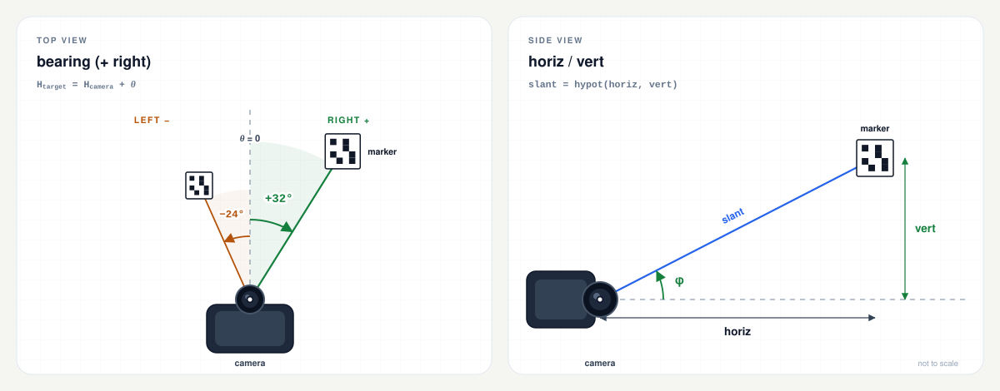

# arucocam

[English](README.md) | [繁體中文](README.zh-TW.md) | [简体中文](README.zh-CN.md) | [Español](README.es.md) | [Русский](README.ru.md)

A single static binary that detects ArUco markers and reports each marker's
bearing, horizontal distance, and vertical offset.  It targets Raspberry Pi
robots and other Linux systems: no OpenCV, Python, or config file is needed on
the device.

```bash
$ arucocam --preset cm3-1280 --device /dev/video0 --json
```

```json
{
  "7": {
    "bearing": 22.6,
    "horiz": 1.23,
    "vert": -0.02
  }
}
```

The example is pretty-printed to show the structure.  With `--json`, actual
output is JSON Lines: one compact object per processed frame, one object per
line.  Each marker is keyed by its ID:

- `bearing` is the angle to the marker relative to the camera's forward axis,
  in degrees (right positive, left negative).
- `horiz` is the planar distance to the marker in metres, measured in the
  camera's horizontal plane.
- `vert` is the vertical offset in metres (positive up, negative down).

The 3D distance is `hypot(horiz, vert)`.  See [Output](#output) for the full
contract, including text output and precision.

[](docs/README.md)

## Contents

- [Quick Start](#quick-start)
- [Features](#features)
- [Supported Targets](#supported-targets)
- [Markers](#markers)
- [Calibration](#calibration)
- [Camera Input](#camera-input)
- [Output](#output)
- [Options](#options)
- [Troubleshooting](#troubleshooting)
- [Build](#build)
- [Tests](#tests)
- [Verifying Releases](#verifying-releases)
- [License](#license)
- [Layout](#layout)

## Quick Start

### 1. Pick the Binary

| Device / OS | `uname -m` | Release asset |
| --- | --- | --- |
| Pi Zero, Zero W, Pi 1 (32-bit OS) | `armv6l` | `arucocam-arm32` |
| Pi 3, Pi 4, Pi 5, Zero 2 W, CM4/CM5 (64-bit OS) | `aarch64` | `arucocam-arm64` |
| Later Pi on 32-bit OS | `armv7l` | `arucocam-arm32` |
| Linux x86-64 | `x86_64` | `arucocam-amd64` |

Download it from the [latest release](https://github.com/fernjager/arucocam/releases/latest)
and make it executable:

```bash
ASSET=arucocam-arm64
BASE=https://github.com/fernjager/arucocam/releases/latest/download
wget -O arucocam "$BASE/$ASSET"
chmod +x arucocam
```

Change `ASSET` for your target.  This saves the release asset as `arucocam`.
To install it system-wide later, run
`sudo install -m 0755 arucocam /usr/local/bin/arucocam`.

`wget` is normally available on Raspberry Pi OS and minimal/BusyBox systems.
If it is missing, or its HTTPS support is unavailable, use
`curl -fLo arucocam "$BASE/$ASSET"` instead.  To verify the download first, see
[Verifying Releases](#verifying-releases).

### 2. Check That It Runs

```bash
./arucocam --version
./arucocam --list-presets
```

`--list-presets` prints the intrinsics and horizontal field of view for every
supported module.  Pick the preset closest to your camera.

### 3. Point It at a Marker

```bash
# A V4L2 capture device:
./arucocam --preset v2-640 --device /dev/video0 --json

# A libcamera/rpicam producer:
rpicam-vid -t 0 --codec yuv420 --width 640 --height 480 --framerate 15 --inline -o - |
  ./arucocam --preset v2-640 --stdin --json
```

Print a marker from the same dictionary (the default is `DICT_4X4_50`) and set
`--marker-size` to the measured width of the black square in millimetres.  The
default is 100 mm.  See [Markers](#markers).

If `/dev/video0` is not your camera, or your camera is only exposed through
libcamera, see [Camera Input](#camera-input).

The rest of this README writes `arucocam` as if it is on `PATH`.  While running
the downloaded binary from this directory, use `./arucocam`.

## Features

- [Preset Calibration Settings](#presets) for common Raspberry Pi and Arducam
  camera modules at 640x480, 1280x720, and 1920x1080.
- No config files: every parameter can be set on the command line.
- No OpenCV or Python runtime on the target.  The binaries are statically
  linked against musl.
- V4L2 capture, stdin streams (I420, MJPEG, or raw gray), and single still
  images.
- Compact JSON Lines for controllers, plus human-readable text and
  `--detect-only` diagnostics.
- ARMv6 build pinned to VFPv2 and checked for absence of NEON, so it runs on
  the Pi Zero and Pi 1 as well as later 32-bit Raspberry Pi OS.

## Supported Targets

| Target | Boards / systems | Binary | Build |
| --- | --- | --- | --- |
| `armv6` | Pi Zero, Pi Zero W, Pi 1 | `dist/arucocam-arm32` | ARM1176JZF-S, VFPv2, **no NEON** |
| `arm64` | Pi 3, Pi 4, Pi 5, Zero 2 W, CM4/CM5 | `dist/arucocam-arm64` | ARMv8-A AArch64 |
| `amd64` | Linux x86-64 | `dist/arucocam-amd64` | generic x86-64, SSE2 baseline |

All three binaries are Linux ELF executables, statically linked against musl.
They run on glibc and musl distributions without OpenCV installed.  The ARMv6
binary also runs on later 32-bit Raspberry Pi OS; a normal armhf binary may
link and then die on the ARM1176 because it contains NEON instructions.

Direct V4L2 capture needs Linux and a V4L2 capture device.  On modern Raspberry
Pi OS the camera stack is libcamera, so the stdin path is often the simplest
way to use a Pi camera.  See [Camera Input](#camera-input).

## Markers

`arucocam` detects ArUco markers.  The practical rules:

- **Dictionary.**  The printed marker and `--dict` must use the same
  dictionary.  The default is `DICT_4X4_50`.  Dictionary names are
  case-insensitive.
- **ID.**  The ID is encoded in the marker.  Use `--target-id 7` to report only
  marker 7; without it, every marker that passes the pose gate is processed.
- **Size.**  `--marker-size` is the edge length of the outer black square in
  millimetres.  It is not the paper size, the image size, or the white quiet
  zone.  The default is 100 mm.
- **Quiet zone.**  Keep a white border around the marker.  Markers generated
  with OpenCV's default `borderBits=1` include one module of border.
- **Printing.**  Print at 100% / actual size and measure the black square with
  calipers.  A 1 mm error on a 100 mm marker is a 1% distance bias.
- **Mounting.**  Keep the marker flat, rigid, matte, and evenly lit.  Glare,
  wrinkles, and motion blur degrade the pose.  The detector does not report
  marker orientation, only position.

To generate a marker on a workstation (OpenCV Python is not needed on the
target):

```python
import cv2

dictionary = cv2.aruco.getPredefinedDictionary(cv2.aruco.DICT_4X4_50)
marker = cv2.aruco.generateImageMarker(dictionary, 7, 800)
cv2.imwrite("marker-7.png", marker)
```

Print `marker-7.png` at actual size.  The 800x800 image includes the white
border; measure the black square, which is smaller than the image, for
`--marker-size`.

The test helper `tests/gen_marker.cpp` can also render a marker into a PGM
canvas, but it is built only with the test suite and is not installed.

## Calibration

Use a preset:

```bash
arucocam --preset fisheye160-640 --device /dev/video0 --json
```

Or pass intrinsics directly:

```bash
arucocam --fx 600 --fy 600 --cx 320 --cy 240 \
         --width 640 --height 480 --marker-size 100 --device /dev/video0 --json
```

- `--fx/--fy` are required unless `--preset` is used.
- `--cx/--cy` default to the image centre.
- `--k1..--k4` are fisheye distortion coefficients; default `0`.
- `--preset` cannot be combined with `--fx/--fy/--cx/--cy/--k1..--k4` or
  `--width/--height`.
- A preset sets `--width`, `--height`, `--fx`, `--fy`, `--cx`, and `--cy`, and
  sets the distortion coefficients to zero.  It does **not** set
  `--marker-size`.
- `--marker-size` is the **outer black square** in millimetres, not the paper
  or quiet-zone size.  Default `100`.
- Capture and calibrate at the same aspect ratio; using the same resolution is
  simplest.  If the frame has a different size but a matching aspect ratio
  (within 0.5%), the intrinsics are scaled to the frame; otherwise the program
  exits with an aspect mismatch error.

A preset is a starting point, not a calibration.  For metric distance, calibrate
`fx`, `fy`, `cx`, `cy` and distortion with `cv::fisheye::calibrate` or a
checkerboard tool.  Focus the camera before calibrating and lock autofocus if
the module allows it.

### Presets

Names are lowercase and case-sensitive, in the form `<family>-<resolution>`:
`-640` is 640x480, `-1280` is 1280x720, `-1920` is 1920x1080.  Run
`arucocam --list-presets` to print these values and the horizontal FOV as a
table.

| Family | Module / optics | Horizontal FOV | fx=fy at 640 / 1280 / 1920 | 100 mm marker px at 1 m / 3 m |
| --- | --- | ---: | ---: | ---: |
| `v1` | Camera Module V1 / NoIR / Pi Zero camera (OV5647, 3.6 mm) | 53.5° | 635 / 1270 / 1905 | 64 / 21 |
| `v2` | Camera Module V2 / NoIR (IMX219, 3.04 mm) | 62.2° | 530 / 1061 / 1591 | 53 / 18 |
| `cm3` | Camera Module 3 (IMX708, 4.74 mm) | 66° | 493 / 985 / 1478 | 49 / 16 |
| `cm3wide` | Camera Module 3 Wide (IMX708, 2.75 mm) | 102° | 259 / 518 / 777 | 26 / 9 |
| `aicam` | AI Camera (IMX500, 4.74 mm) | 66.3° | 490 / 980 / 1470 | 49 / 16 |
| `imx519` | Arducam 16MP IMX519 autofocus, stock lens | 66° | 493 / 985 / 1478 | 49 / 16 |
| `hawkeye` | Arducam 64MP Hawk-Eye autofocus, stock lens (OV64A40) | 72° | 440 / 881 / 1321 | 44 / 15 |
| `owlsight` | Arducam 64MP OwlSight, 6.65 mm lens (OV64A40) | 68° | 474 / 949 / 1423 | 47 / 16 |
| `fisheye160` | 160° diagonal OV5647 fisheye | 160° diag (≈128° H) | 286 / 573 / 860 | 29 / 10 |

Full names: `v1-640`, `v1-1280`, `v1-1920`, and likewise for the other families.
HFOV is the same at all three resolutions because it depends on the lens.

The Arducam rows assume the stock lens listed; a different lens changes `fx`.
Treat them as starting points, not calibrations.  NoIR variants use the same
preset as the colour version.

The marker-width column uses the 640 px preset and a 100 mm black square.
At 1280 and 1920 the marker is roughly twice and three times as wide, unless
`--process-width` brings processing back to 640.

Notes:

- 160° is the **diagonal** FOV of the fisheye.  The 16:9 presets crop the 4:3
  sensor vertically, so their diagonal FOV is closer to 147°.
- The `cm3-640` and `cm3wide-640` presets are approximate because those sensors
  are 16:9; prefer 1280x720 with `--process-width 640` on a Pi Zero.
- HQ Camera and Global Shutter Camera have C/CS lenses; there is no universal
  preset.  Use `--fx/--fy` or calibrate.

If a preset is far off, calibrate rather than tweaking `fx` by eye.

## Camera Input

Choose exactly one source.  `--image`, `--stdin`, and `--device` are mutually
exclusive; if none is given, the program opens `/dev/video0` through V4L2.

| Source | Use it for | Notes |
| --- | --- | --- |
| `--image PATH` | One still frame | PGM, PNG, or JPEG; exits after one frame |
| `--device PATH` | Linux V4L2 capture | Default `/dev/video0`; must expose a supported format |
| `--stdin` | libcamera/rpicam, GStreamer, or another process | Raw I420/gray or MJPEG; set `--width/--height` to the producer's frame size |

### V4L2 Camera

```bash
arucocam --preset fisheye160-640 --device /dev/video0 --json
arucocam --preset fisheye160-1280 --process-width 640 \
         --device /dev/video0 --max-fps 10 --json
```

`--device` defaults to `/dev/video0`.  Find capture nodes with:

```bash
sudo apt install v4l-utils
v4l2-ctl --list-devices
```

The V4L2 path prefers direct-luma formats: `GREY`, `YUV420`, `NV12`, `YUYV`,
`UYVY`, then `MJPEG`/`JPEG`, then `RGB24`/`BGR24`.  YUYV is what the Pi
`bcm2835-v4l2` driver normally offers.  The program requests the size given by
`--width`/`--height` and fails if the driver cannot provide a supported format
at that size.

`--max-fps` caps **processing** and drops stale frames; use `--max-fps 5` when
the CPU is pinned.  The program does not set the camera frame rate or write
camera controls: exposure, gain/ISO, white balance, and frame rate stay
whatever `v4l2-ctl` or the driver put in place.  Some drivers reset controls on
a format change, so verify them while the program is running.

If the camera exposes only H.264 or another unsupported format, or if it is
only available through libcamera, use the stdin path with a producer that emits
I420 or MJPEG (for example `rpicam-vid --codec yuv420`).

### Stdin

```bash
rpicam-vid -t 0 --codec yuv420 --width 640 --height 480 --framerate 15 --inline -o - |
  arucocam --preset fisheye160-640 --stdin --json
```

`rpicam-vid` is the Bookworm name; older Bullseye images use `libcamera-vid`.
`--codec yuv420` produces raw I420.  For MJPEG:

```bash
rpicam-vid -t 0 --codec mjpeg --width 1280 --height 720 --framerate 30 --inline -o - |
  arucocam --preset v2-1280 --stdin --stdin-format mjpeg --json
```

`--stdin-format` defaults to `auto`: the program peeks at the first two bytes,
treats a JPEG start-of-image as MJPEG, and treats anything else as raw I420.
Use `--stdin-format gray` for raw 8-bit grayscale, or `mjpeg` if a producer
emits JPEG.  Accepted aliases are `jpeg` for `mjpeg`, `yuv420`/`yuv` for
`i420`, and `grey`/`raw` for `gray`.

Raw formats require `--width` and `--height`; I420 also requires both to be
even.  Set `--width/--height` to the producer's frame size for every stdin
source: MJPEG can decode its own dimensions, but the flags still define the
calibration geometry.  A mismatch can desynchronise raw frames or trigger an
aspect-ratio error.

`--frames N` is useful for a smoke test, and `--max-fps` limits processing
without changing the producer's frame rate.  There is one output record per
decoded frame; no timestamp is attached.

### Still Image

```bash
arucocam --preset fisheye160-640 --image frame.pgm --json
arucocam --preset fisheye160-640 --detect-only --image frame.pgm
```

`--image` accepts PGM, PNG, or JPEG and processes a single frame.  A still
image defaults to `--confirm 1` unless `--confirm` is given explicitly.  Do not
pass `--confirm` greater than 1 with a single image: the marker can never
accumulate enough consecutive frames to be confirmed in **JSON** output (text
output prints a valid pose immediately).

The image must match the calibration aspect ratio (exact resolution is
simplest).  If it does not, the program reports an aspect mismatch; use a
matching preset or pass the image's `--width`/`--height` and intrinsics.

## Output

### JSON

`--json` emits JSON Lines: one compact object per processed frame, followed by
a newline and flushed immediately.  There is no enclosing array and no
timestamp.

```json
{"7":{"bearing":2.6,"horiz":1.23,"vert":-0.02},"8":{"bearing":-11.4,"horiz":0.82,"vert":0.03}}
```

- Keys are marker IDs as JSON strings, sorted ascending.
- Only markers that are **confirmed** and have a valid pose are included.
- No marker: `{}` (or `{"_timing":{...}}` with `--timing`).
- Multiple markers: one key per marker.
- No timestamp is emitted; timestamp on receipt in the controller.  There is
  no target, debug, or full-pose record.
- `--target-id N` filters the output; detection still runs for all markers.
- `_timing` is a reserved key and is only present with `--timing`.

| Field | Unit | Meaning |
| --- | --- | --- |
| `bearing` | degrees | Positive right (CW), −180 to 180 |
| `horiz` | metres | Planar distance in the camera's horizontal plane |
| `vert` | metres | Vertical offset, positive up, relative to the camera |

Body frame: `x` forward, `y` left, `z` up.  The origin is the camera's optical
centre.  `bearing = 0` is the forward axis, normally the image centre; a
calibrated principal point can be slightly off centre.

The reported bearing is compass-style, not the body-frame polar angle.
Reconstruct the marker position with:

```text
x       = horiz * cos(bearing)
y_left  = -horiz * sin(bearing)
z       = vert
```

If the camera's forward axis has compass heading `H_camera`, the marker's
absolute compass bearing is:

```text
H_target = H_camera + bearing
```

`vert` is not height above the floor; it is the marker's vertical offset from
the camera.  The true 3D distance is `hypot(horiz, vert)`.

Full diagrams: [top view](docs/bearing-top-view.svg) ·
[side view](docs/bearing-side-view.svg) ·
[geometry notes](docs/README.md).

`--timing` adds a reserved `_timing` key to each JSON line:

```json
{"7":{"bearing":2.6,"horiz":1.23,"vert":-0.02},"_timing":{"processMs":12.345}}
```

`processMs` is the time spent in detection/PnP for that frame, excluding JSON
output and `--max-fps` sleep.  It only affects JSON when explicitly requested.
`--timing` requires `--json`.

A compact binary transport is reserved for a future version; it is **not**
implemented.  The JSON field names and units are the stable interface for now.
The planned layout is in [docs/binary-protocol.md](docs/binary-protocol.md).

### Text Output

Without `--json`, output is human-readable:

```text
id=7 bearing=+2.6deg horiz=1.23m vert=-0.02m
```

Add `--verbose` for RMS and pixel area:

```text
id=7 bearing=+2.6deg horiz=1.23m vert=-0.02m rms=0.42px area=4096px
```

JSON waits for `--confirm` consecutive valid frames.  Text output is a
diagnostic stream: it prints a pose-valid marker immediately, even before it is
confirmed, so `--confirm` does not delay text output.  If a marker is detected
but fails the pose gate, text output reports it; JSON does not:

```text
id=7 detected center=(320.0,240.0) area=1200px rejected rms=8.20px
```

`--detect-only` skips PnP and prints detected IDs, pixel centres, and areas; it
is text-only and cannot be combined with `--json`:

```text
id=7 detected center=(320.0,240.0) area=4096px
```

When there is nothing to report, text output prints `no markers`.  `--verbose`
is text-only; it cannot be combined with `--json`.

### Exit Status and Signals

- `0`: normal completion, including `--help`, `--version`, `--list-presets`,
  streams that end, and runs that find no markers.
- `1`: invalid options, calibration failure, I/O error, or capture/decode
  error.  The message is written to stderr as `arucocam: error: ...`.
- `SIGINT` / `SIGTERM`: stop after the current frame and exit `0`.
- A per-frame OpenCV error is reported as `arucocam: frame N: ...` and
  processing continues.

### Precision

Values are printed to 0.1° and 0.01 m.  That is display resolution, not
accuracy.  With a 100 mm marker processed at 640 px, expect roughly 0.1-0.5°
bearing and 1-3% horizontal/vertical error at short distances, 5-10% at longer
distances; fisheye presets are at the worse end.  A 1 mm error in the marker's
black square is a 1% distance bias, and a preset is not a calibration.

`--max-rms` and `--min-area` are gates in the **processed** image, so
`--process-width` changes their effective values and the reported `area`.
`--confirm` gates JSON output; it does not average or filter, and text output
does not wait for it.  There is no temporal smoothing.

For better results, calibrate the lens, use `--corner-refine subpix`, keep the
marker large in the frame, and tighten `--max-rms` / `--min-area`.  Motion
blur, rolling shutter, and grazing viewing angles all hurt pose accuracy.
Measure `processMs` with `--timing` on the target rather than extrapolating from
another machine.

## Options

Value options accept either `--name value` or `--name=value`.  A single
positional argument is treated as `--image`.

### Source

| Option | Default | Effect |
| --- | --- | --- |
| `--image PATH` | — | One still image (PGM/PNG/JPEG); exit after it. |
| `--stdin` | off | Read a frame stream from standard input. |
| `--stdin-format FMT` | `auto` | `auto`, `mjpeg`, `i420`, or `gray` (aliases above). |
| `--device PATH` | `/dev/video0` | V4L2 capture device; used when no other source is given. |
| `--frames N` | `0` | Stop after N processed frames; `0` = until EOF or signal. |
| `--max-fps N` | `0` | Cap processed frames/sec; `0` = unlimited. |

### Intrinsics and Marker

| Option | Default | Effect |
| --- | --- | --- |
| `--preset NAME` | — | Starting intrinsics for a common module; sets width, height, cx, cy, fx, fy, and k1..k4 = 0. |
| `--fx`, `--fy` | required unless `--preset` | Focal length in pixels. |
| `--cx`, `--cy` | width/2, height/2 | Principal point in pixels. |
| `--k1`..`--k4` | `0` | Fisheye distortion coefficients. |
| `--width`, `--height` | `640`, `480` | Capture/calibration size; not with `--preset`. |
| `--marker-size MM` | `100` | Outer black square, millimetres. |
| `--dict NAME` | `DICT_4X4_50` | ArUco dictionary; case-insensitive. |

### Detection

| Option | Default | Effect |
| --- | --- | --- |
| `--process-width N` | `640` | Downscale before detection; `0` = full size.  Never upscales. |
| `--corner-refine MODE` | `none` | `none`, `subpix`, `contour`, or `apriltag`. |
| `--max-rms PX` | `5` | Reject poses above this reprojection RMS, in processed pixels. |
| `--min-area PX2` | `50` | Reject markers smaller than this, in processed pixels. |
| `--detect-only` | off | Skip PnP; print IDs, centres, and areas. Text-only. |
| `--aruco3` | off | Enable Aruco3.  Benchmark first; it can be slower at 640x480. |
| `--target-id N` | all (`-1`) | Output filter; detection still runs for every marker. |
| `--confirm N` | `3` | Consecutive valid frames before a marker is confirmed in JSON.  Text output prints valid poses immediately.  Still images default to 1. |

### Output and General

| Option | Default | Effect |
| --- | --- | --- |
| `--json` | off | Compact JSON Lines instead of text. |
| `--verbose` | off | Add RMS/area to text output; not with `--json`. |
| `--timing` | off | Add `_timing.processMs`; requires `--json`. |
| `--list-presets` | — | Print preset names, intrinsics, and horizontal FOV. |
| `--help`, `-h` | — | Print help and exit. |
| `--version` | — | Print the version and exit. |

Validation is strict: unknown options, multiple sources, `--preset` combined
with manual calibration or resolution flags, `--detect-only` with `--json`,
`--verbose` with `--json`, and `--timing` without `--json` are all errors.

### Dictionaries

Case-insensitive.  Supported:

`DICT_4X4_50`, `DICT_4X4_100`, `DICT_4X4_250`, `DICT_4X4_1000`,
`DICT_5X5_50`, `DICT_5X5_100`, `DICT_5X5_250`, `DICT_5X5_1000`,
`DICT_6X6_50`, `DICT_6X6_100`, `DICT_6X6_250`, `DICT_6X6_1000`,
`DICT_7X7_50`, `DICT_7X7_100`, `DICT_7X7_250`, `DICT_7X7_1000`,
`DICT_ARUCO_ORIGINAL`, `DICT_APRILTAG_16h5`, `DICT_APRILTAG_25h9`,
`DICT_APRILTAG_36h10`, `DICT_APRILTAG_36h11`.

The printed marker and the detector must use the same dictionary.

## Troubleshooting

**`{}` every frame.**  No confirmed, valid marker.  Check the dictionary,
marker size, focus, lighting, and that `--preset`/intrinsics match the capture
resolution.  Use `--detect-only` to see whether the marker is found at all.

**`no markers` every frame.**  The text equivalent of `{}`.  If
`--detect-only` finds the ID but normal output only shows
`detected ... rejected`, the pose is being rejected; inspect the `rejected rms`
value and check `--max-rms`, `--min-area`, and `--marker-size`.

**`cannot open /dev/video0` or permission denied.**  Check
`v4l2-ctl --list-devices` and make sure your user can read the device.  On
Raspberry Pi OS:

```bash
sudo usermod -aG video "$USER"
# log out and back in, then retry
```

If the camera is not a V4L2 device, use the stdin path.

**`no supported V4L2 format`.**  The camera does not expose a supported raw or
MJPEG format at the requested size.  Try a different `--width/--height`, or
pipe I420/MJPEG from `rpicam-vid`/`libcamera-vid` through `--stdin`.

**`--stdin` produces nothing or garbage.**  The producer's format and
`--stdin-format` disagree, or `--width/--height` do not match the frame size.
Start with `--stdin-format auto`, check the producer's codec, and use
`--frames 1` while debugging.  Raw I420 needs even dimensions.

**Horiz is consistently high or low.**  `--marker-size` is probably wrong, or
the focal length is wrong.  Measure the printed black square, not the paper.

**`image is ... aspect mismatch`.**  Calibrate at the capture resolution or use
a mode with the same aspect ratio.  Cropping changes `cx/cy`.

**A marker appears late in JSON.**  It needs `--confirm` consecutive valid
poses.  Text output does not wait for confirmation.  For a single image this is
automatically 1 unless you pass `--confirm`; a still image with `--confirm 3`
can never appear in JSON.

**JSON is empty but text shows detections.**  The text output includes
detected-but-rejected and not-yet-confirmed poses; JSON includes only
confirmed, pose-valid markers.  Loosen `--max-rms`/`--min-area` only after
checking the marker size and calibration.

**The marker is only detected when close.**  Keep more pixels on the marker:
raise `--process-width` (or use `0`), lower `--min-area`, and avoid aggressive
downscaling on a Pi Zero.

**Values jump between frames.**  Reduce motion blur, improve lighting, use
`--corner-refine subpix`, and increase `--confirm` for JSON consumers.
`--confirm` gates noisy frames; it does not average them, and text output does
not wait for it.

**CPU pinned.**  Lower `--process-width`, use `--corner-refine none`, and cap
processing with `--max-fps 5`.  The camera rate is set with
`v4l2-ctl --set-parm` (or left at the driver default).  `--aruco3` can help on
larger frames or a Pi Zero, but was slower at 640x480 in QEMU; benchmark on the
target.

**Brightness/exposure.**  The camera is converted to grayscale, so white
balance does not affect detection; exposure and ISO/gain do.  Use
`v4l2-ctl --list-ctrls` / `--set-ctrl` (and `--set-parm` if needed), or the
`rpicam-vid` options when piping.  Some drivers reset controls on a format
change, so verify them while the program is running.

**Camera is busy.**  Another process (including a preview) may hold the device.
Stop it before opening the V4L2 node.

## Build

Builds and checks run in Docker; no host OpenCV or cross compiler is needed.
You need Docker Engine or Docker Desktop with `buildx`, network access for the
pinned toolchain and OpenCV downloads, and enough disk space for the build
images.  The build downloads pinned prebuilt Bootlin Buildroot toolchain
tarballs (mirrored as GitHub release assets), verifies their SHA-256, and
builds OpenCV 4.14.0 statically for each target.  Those toolchains are
x86_64-host binaries, so the build image is `linux/amd64` even on Apple
silicon; Docker emulates it, which is slower.

```bash
make help               # list targets and current settings

make pi32               # dist/arucocam-arm32    (ARMv6)
make check32            # ELF + functional + preset/dictionary tests

make pi64               # dist/arucocam-arm64    (AArch64)
make check64

make amd64              # dist/arucocam-amd64    (Linux x86-64)
make check-amd64
```

`make pi32` is the default target.  The first build for a target compiles
OpenCV and can take a while; later builds reuse the Docker layers.  The checks
run under QEMU inside the target image.  The build image is
`arucocam-build:<target>`; `make shell` opens it.

Other useful targets:

```bash
make inspect            # verify the built ELF (static, target ISA)
make tidy               # clang-tidy inside the build image
make clean              # remove build/out and dist
make distclean          # clean + remove the build images
```

The GitHub Actions workflow builds and tests all three targets and uploads
`arucocam-arm32` / `arucocam-arm64` / `arucocam-amd64`; tagged builds also
publish `SHA256SUMS`, a licenses archive, and build provenance.  `v*` tags
create a release.

The default build is pinned to OpenCV 4.14.0, the Bootlin Buildroot 2026.08
musl toolchains (GCC 15.3.0, musl 1.2.6), and a pinned `debian:trixie-slim`
base image.  The Dockerfile verifies the toolchain and OpenCV downloads against
their SHA-256 values and pins the base image by digest.  The exact URLs,
checksums, base image digest, and independent verification commands are in
[docs/build-provenance.md](docs/build-provenance.md).

## Tests

`make check32`, `make check64`, and `make check-amd64` build the test helper
and run, under QEMU:

- no-argument help, `--help`, `--version`, `--list-presets`
- compact JSON schema and pose tolerances
- bearing sign: right of centre positive, left negative
- marker-size scaling and default 100 mm
- `--target-id`, empty maps, `--detect-only`, `--verbose`
- JSON `--timing.processMs`
- Aruco3 opt-in with `--aruco3`
- `--max-fps` validation
- multi-frame I420/auto-stdin confirmation and loss
- I420 odd-width/height rejection
- preset/manual conflict rejection
- all presets on matching blank frames
- all documented dictionaries
- ELF checks: static, ARMv6/VFPv2/no-NEON, AArch64, or x86-64

The test suite is `tests/test_arucocam.py` plus the helpers
`build/scripts/check.sh`, `build/scripts/check-binary.sh`, and
`tests/gen_marker.cpp`; no camera hardware is required.  `make tidy` runs
clang-tidy inside the build image.

## Verifying Releases

Each `v*` release publishes the three binaries, `SHA256SUMS`, and
`arucocam-licenses.tar.gz` (containing `LICENSE`, `THIRD_PARTY_NOTICES.md`,
and `LICENSES/`).  It also carries a GitHub build-provenance attestation.
These commands download the asset under its published name so `SHA256SUMS`
matches directly.

```bash
ASSET=arucocam-arm64
BASE=https://github.com/fernjager/arucocam/releases/latest/download
wget -O "$ASSET" "$BASE/$ASSET"
wget -O SHA256SUMS "$BASE/SHA256SUMS"
sha256sum -c --ignore-missing SHA256SUMS

# Optional: verify the artifact attestation (requires the GitHub CLI)
gh attestation verify "$ASSET" --repo fernjager/arucocam
```

The exact toolchain and OpenCV pins, and commands for checking the upstream
tarballs yourself, are in [docs/build-provenance.md](docs/build-provenance.md).

## License

MIT.  See [LICENSE](LICENSE).  Prebuilt binaries also include third-party
components; see [THIRD_PARTY_NOTICES.md](THIRD_PARTY_NOTICES.md).

## Layout

```text
arucocam/
├── CMakeLists.txt
├── Makefile                    # image / pi32 / pi64 / amd64 / checks
├── build/
│   ├── docker/Dockerfile       # target-aware musl toolchain + static OpenCV
│   ├── cmake/toolchain/        # ARMv6, AArch64, and x86-64 toolchains
│   ├── scripts/                # build, check, ELF-check, tidy helpers
│   └── out/                    # generated per-target CMake build trees
├── dist/                       # generated release binaries
├── docs/
│   ├── README.md               # geometry notes and convention details
│   ├── binary-protocol.md      # reserved future binary transport
│   ├── build-provenance.md     # pinned toolchains, OpenCV, and checksums
│   ├── gen_bearing_diagrams.py
│   ├── bearing-compact.*       # two-panel README banner
│   ├── bearing-top-view.*      # full top view
│   └── bearing-side-view.*     # full side view
├── src/
│   ├── main.cpp                # CLI and frame loop
│   ├── calibration.*           # intrinsics and validation
│   ├── detector.*              # ArUco, fisheye PnP, confirmation
│   ├── frame_source.*          # image / stdin I420 / MJPEG
│   ├── v4l2_source.*           # Linux V4L2 mmap capture
│   └── output.*                # compact JSON and text
├── tests/
│   ├── gen_marker.cpp          # synthetic marker image
│   └── test_arucocam.py        # functional tests under qemu
├── .clang-format
├── .clang-tidy
├── .editorconfig
├── .github/workflows/ci.yml    # ARMv6 + ARM64 + x86-64 builds/releases
├── LICENSE
├── LICENSES/                   # third-party license texts
├── README.es.md                # Spanish translation
├── README.md
├── README.ru.md                # Russian translation
├── README.zh-CN.md             # Simplified Chinese translation
├── README.zh-TW.md             # Traditional Chinese translation
└── THIRD_PARTY_NOTICES.md
```
