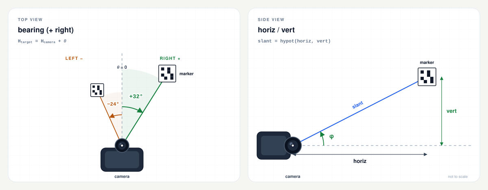

# arucocam

[English](README.md) | [繁體中文](README.zh-TW.md) | [简体中文](README.zh-CN.md) | [Español](README.es.md) | [Русский](README.ru.md)

> Это перевод [README на английском языке](README.md); при расхождениях приоритет имеет английская версия.

Единый статический бинарный файл, который детектирует маркеры ArUco и сообщает
для каждого маркера его пеленг (bearing), горизонтальное расстояние (horiz) и
вертикальное смещение (vert). Он предназначен для роботов на Raspberry Pi и
других Linux-систем: на устройстве не требуются OpenCV, Python или файл
конфигурации.

```bash
$ arucocam --preset cm3-1280 --device /dev/video0 --json
```

```json
{
  "7": {
    "bearing": 22.6,
    "horiz": 1.23,
    "vert": -0.02
  }
}
```

Пример отформатирован с отступами, чтобы показать структуру. При использовании
`--json` фактический вывод представляет собой JSON Lines: один компактный
объект на каждый обработанный кадр, по одному объекту в строке. Каждый маркер
идентифицируется по ID:

- `bearing` — угол на маркер относительно передней оси камеры в градусах
  (вправо положительный, влево отрицательный).
- `horiz` — расстояние до маркера в метрах, измеренное в горизонтальной
  плоскости камеры.
- `vert` — вертикальное смещение в метрах (вверх положительное, вниз
  отрицательное).

Трёхмерное расстояние равно `hypot(horiz, vert)`. Полное описание контракта,
включая текстовый вывод и точность, см. в разделе [Вывод](#вывод).

[](docs/README.md)

## Содержание

- [Быстрый старт](#быстрый-старт)
- [Возможности](#возможности)
- [Поддерживаемые платформы](#поддерживаемые-платформы)
- [Маркеры](#маркеры)
- [Калибровка](#калибровка)
- [Ввод с камеры](#ввод-с-камеры)
- [Вывод](#вывод)
- [Параметры](#параметры)
- [Устранение неполадок](#устранение-неполадок)
- [Сборка](#сборка)
- [Тесты](#тесты)
- [Проверка релизов](#проверка-релизов)
- [Лицензия](#лицензия)
- [Структура проекта](#структура-проекта)

## Быстрый старт

### 1. Выбор бинарного файла

| Устройство / ОС | `uname -m` | Файл релиза |
| --- | --- | --- |
| Pi Zero, Zero W, Pi 1 (32-битная ОС) | `armv6l` | `arucocam-arm32` |
| Pi 3, Pi 4, Pi 5, Zero 2 W, CM4/CM5 (64-битная ОС) | `aarch64` | `arucocam-arm64` |
| Более поздние Pi с 32-битной ОС | `armv7l` | `arucocam-arm32` |
| Linux x86-64 | `x86_64` | `arucocam-amd64` |

Скачайте его из [последнего релиза](https://github.com/fernjager/arucocam/releases/latest)
и сделайте исполняемым:

```bash
ASSET=arucocam-arm64
BASE=https://github.com/fernjager/arucocam/releases/latest/download
wget -O arucocam "$BASE/$ASSET"
chmod +x arucocam
```

Измените `ASSET` в соответствии с вашей платформой. Так файл релиза сохраняется
под именем `arucocam`. Чтобы позже установить его в систему, выполните
`sudo install -m 0755 arucocam /usr/local/bin/arucocam`.

`wget` обычно доступен в Raspberry Pi OS и минимальных системах/BusyBox. Если
его нет или поддержка HTTPS недоступна, используйте вместо него
`curl -fLo arucocam "$BASE/$ASSET"`. Чтобы сначала проверить загрузку, см.
[Проверка релизов](#проверка-релизов).

### 2. Проверка запуска

```bash
./arucocam --version
./arucocam --list-presets
```

`--list-presets` выводит внутренние параметры и горизонтальный угол обзора для
каждого поддерживаемого модуля. Выберите пресет, ближайший к вашей камере.

### 3. Наведите камеру на маркер

```bash
# A V4L2 capture device:
./arucocam --preset v2-640 --device /dev/video0 --json

# A libcamera/rpicam producer:
rpicam-vid -t 0 --codec yuv420 --width 640 --height 480 --framerate 15 --inline -o - |
  ./arucocam --preset v2-640 --stdin --json
```

Напечатайте маркер из того же словаря (по умолчанию `DICT_4X4_50`) и задайте
`--marker-size` равным измеренной ширине чёрного квадрата в миллиметрах. По
умолчанию — 100 мм. См. [Маркеры](#маркеры).

Если `/dev/video0` — не ваша камера или камера доступна только через libcamera,
см. [Ввод с камеры](#ввод-с-камеры).

В остальной части этого README предполагается, что `arucocam` находится в
`PATH`. Если вы запускаете скачанный файл из этого каталога, используйте
`./arucocam`.

## Возможности

- [Настройки калибровки из пресетов](#пресеты) для распространённых камерных
  модулей Raspberry Pi и Arducam при 640x480, 1280x720 и 1920x1080.
- Без файлов конфигурации: все параметры можно задать в командной строке.
- На целевой системе не требуются OpenCV или Python во время выполнения.
  Бинарные файлы статически слинкованы с musl.
- Захват V4L2, потоки через stdin (I420, MJPEG или сырое полутоновое
  изображение) и отдельные неподвижные изображения.
- Компактный JSON Lines для контроллеров, а также удобочитаемый текст и
  диагностика `--detect-only`.
- Сборка ARMv6, нацеленная на VFPv2, с проверкой отсутствия NEON, поэтому она
  работает на Pi Zero и Pi 1, а также на более поздних 32-битных Raspberry Pi OS.

## Поддерживаемые платформы

| Платформа | Платы / системы | Бинарный файл | Сборка |
| --- | --- | --- | --- |
| `armv6` | Pi Zero, Pi Zero W, Pi 1 | `dist/arucocam-arm32` | ARM1176JZF-S, VFPv2, **без NEON** |
| `arm64` | Pi 3, Pi 4, Pi 5, Zero 2 W, CM4/CM5 | `dist/arucocam-arm64` | ARMv8-A AArch64 |
| `amd64` | Linux x86-64 | `dist/arucocam-amd64` | обычный x86-64, базовый уровень SSE2 |

Все три бинарных файла — исполняемые файлы Linux ELF, статически слинкованные с
musl. Они работают в дистрибутивах на glibc и musl без установленного OpenCV.
Бинарный файл ARMv6 также работает на более поздних 32-битных Raspberry Pi OS;
обычный armhf-бинарный файл может слинковаться, а затем упасть на ARM1176,
поскольку содержит инструкции NEON.

Для прямого захвата через V4L2 требуются Linux и устройство захвата V4L2. В
современных Raspberry Pi OS стек камеры — libcamera, поэтому путь через stdin
часто является самым простым способом использовать камеру Pi. См.
[Ввод с камеры](#ввод-с-камеры).

## Маркеры

`arucocam` детектирует маркеры ArUco. Практические правила:

- **Словарь.** Напечатанный маркер и `--dict` должны использовать один и тот же
  словарь. По умолчанию — `DICT_4X4_50`. Имена словарей нечувствительны к
  регистру.
- **ID.** ID закодирован в маркере. Используйте `--target-id 7`, чтобы сообщать
  только о маркере 7; без этого обрабатывается каждый маркер, прошедший проверку
  позы.
- **Размер.** `--marker-size` — длина стороны внешнего чёрного квадрата в
  миллиметрах. Это не размер бумаги, не размер изображения и не белая тихая
  зона. По умолчанию — 100 мм.
- **Тихая зона.** Оставляйте белую рамку вокруг маркера. Маркеры, сгенерированные
  с параметром OpenCV по умолчанию `borderBits=1`, включают один модуль рамки.
- **Печать.** Печатайте при 100 % / фактическом размере и измеряйте чёрный
  квадрат штангенциркулем. Ошибка в 1 мм на маркере 100 мм даёт смещение
  расстояния в 1 %.
- **Установка.** Держите маркер плоским, жёстким, матовым и равномерно
  освещённым. Блики, складки и смазывание при движении ухудшают позу. Детектор
  не сообщает ориентацию маркера, только положение.

Чтобы сгенерировать маркер на рабочей станции (OpenCV Python на целевой системе
не нужен):

```python
import cv2

dictionary = cv2.aruco.getPredefinedDictionary(cv2.aruco.DICT_4X4_50)
marker = cv2.aruco.generateImageMarker(dictionary, 7, 800)
cv2.imwrite("marker-7.png", marker)
```

Напечатайте `marker-7.png` в фактическом размере. Изображение 800x800 включает
белую рамку; для `--marker-size` измерьте чёрный квадрат, который меньше
изображения.

Вспомогательная тестовая программа `tests/gen_marker.cpp` также может отрисовать
маркер на холсте PGM, но она собирается только вместе с набором тестов и не
устанавливается.

## Калибровка

Используйте пресет:

```bash
arucocam --preset fisheye160-640 --device /dev/video0 --json
```

Или передайте внутренние параметры напрямую:

```bash
arucocam --fx 600 --fy 600 --cx 320 --cy 240 \
         --width 640 --height 480 --marker-size 100 --device /dev/video0 --json
```

- `--fx/--fy` обязательны, если не используется `--preset`.
- `--cx/--cy` по умолчанию равны центру изображения.
- `--k1..--k4` — коэффициенты дисторсии «рыбий глаз»; по умолчанию `0`.
- `--preset` нельзя комбинировать с `--fx/--fy/--cx/--cy/--k1..--k4` или
  `--width/--height`.
- Пресет задаёт `--width`, `--height`, `--fx`, `--fy`, `--cx` и `--cy`, а
  коэффициенты дисторсии устанавливает в ноль. Он **не** задаёт
  `--marker-size`.
- `--marker-size` — это **внешний чёрный квадрат** в миллиметрах, а не размер
  бумаги или тихой зоны. По умолчанию `100`.
- Захватывайте и калибруйте при одном и том же соотношении сторон; проще всего
  использовать одинаковое разрешение. Если кадр имеет другой размер, но
  совпадающее соотношение сторон (в пределах 0,5 %), внутренние параметры
  масштабируются под кадр; иначе программа завершается с ошибкой несовпадения
  соотношения сторон.

Пресет — это отправная точка, а не калибровка. Для метрического расстояния
откалибруйте `fx`, `fy`, `cx`, `cy` и дисторсию с помощью
`cv::fisheye::calibrate` или инструмента с шахматной доской. Сфокусируйте камеру
перед калибровкой и зафиксируйте автофокус, если модуль это позволяет.

### Пресеты

Имена записываются строчными буквами и чувствительны к регистру, в форме
`<family>-<resolution>`: `-640` — это 640x480, `-1280` — 1280x720, `-1920` —
1920x1080. Выполните `arucocam --list-presets`, чтобы вывести эти значения и
горизонтальный угол обзора в виде таблицы.

| Семейство | Модуль / оптика | Горизонтальный угол обзора | fx=fy при 640 / 1280 / 1920 | Маркер 100 мм, px на 1 м / 3 м |
| --- | --- | ---: | ---: | ---: |
| `v1` | Camera Module V1 / NoIR / камера Pi Zero (OV5647, 3,6 мм) | 53,5° | 635 / 1270 / 1905 | 64 / 21 |
| `v2` | Camera Module V2 / NoIR (IMX219, 3,04 мм) | 62,2° | 530 / 1061 / 1591 | 53 / 18 |
| `cm3` | Camera Module 3 (IMX708, 4,74 мм) | 66° | 493 / 985 / 1478 | 49 / 16 |
| `cm3wide` | Camera Module 3 Wide (IMX708, 2,75 мм) | 102° | 259 / 518 / 777 | 26 / 9 |
| `aicam` | AI Camera (IMX500, 4,74 мм) | 66,3° | 490 / 980 / 1470 | 49 / 16 |
| `imx519` | Arducam 16MP IMX519 с автофокусом, штатный объектив | 66° | 493 / 985 / 1478 | 49 / 16 |
| `hawkeye` | Arducam 64MP Hawk-Eye с автофокусом, штатный объектив (OV64A40) | 72° | 440 / 881 / 1321 | 44 / 15 |
| `owlsight` | Arducam 64MP OwlSight, объектив 6,65 мм (OV64A40) | 68° | 474 / 949 / 1423 | 47 / 16 |
| `fisheye160` | 160° диагональный объектив «рыбий глаз» OV5647 | 160° по диагонали (≈128° по горизонтали) | 286 / 573 / 860 | 29 / 10 |

Полные имена: `v1-640`, `v1-1280`, `v1-1920` и аналогично для остальных
семейств. Горизонтальный угол обзора одинаков при всех трёх разрешениях,
поскольку зависит от объектива.

Строки Arducam предполагают указанный штатный объектив; другой объектив изменит
`fx`. Рассматривайте их как отправные точки, а не калибровки. Варианты NoIR
используют тот же пресет, что и цветная версия.

Столбец ширины маркера использует пресет 640 px и чёрный квадрат 100 мм. При
1280 и 1920 маркер примерно в два и в три раза шире, если только
`--process-width` не возвращает обработку к 640.

Примечания:

- 160° — это **диагональный** угол обзора рыбоглазого объектива. Пресеты 16:9
  обрезают сенсор 4:3 по вертикали, поэтому их диагональный угол обзора ближе
  к 147°.
- Пресеты `cm3-640` и `cm3wide-640` приблизительны, поскольку эти сенсоры имеют
  соотношение 16:9; на Pi Zero предпочтительнее 1280x720 с
  `--process-width 640`.
- Камеры HQ Camera и Global Shutter Camera имеют объективы C/CS;
  универсального пресета нет. Используйте `--fx/--fy` или калибруйте.

Если пресет сильно не подходит, откалибруйте камеру, а не подбирайте `fx` на
глаз.

## Ввод с камеры

Выберите ровно один источник. `--image`, `--stdin` и `--device` взаимно
исключают друг друга; если ни один не указан, программа открывает
`/dev/video0` через V4L2.

| Источник | Для чего использовать | Примечания |
| --- | --- | --- |
| `--image PATH` | Один неподвижный кадр | PGM, PNG или JPEG; завершается после одного кадра |
| `--device PATH` | Захват V4L2 в Linux | По умолчанию `/dev/video0`; должен предоставлять поддерживаемый формат |
| `--stdin` | libcamera/rpicam, GStreamer или другой процесс | Сырой I420/серый или MJPEG; задайте `--width/--height` равными размеру кадра производителя |

### Камера V4L2

```bash
arucocam --preset fisheye160-640 --device /dev/video0 --json
arucocam --preset fisheye160-1280 --process-width 640 \
         --device /dev/video0 --max-fps 10 --json
```

`--device` по умолчанию — `/dev/video0`. Найдите узлы захвата с помощью:

```bash
sudo apt install v4l-utils
v4l2-ctl --list-devices
```

Путь V4L2 предпочитает форматы с прямым яркостным каналом: `GREY`, `YUV420`, `NV12`,
`YUYV`, `UYVY`, затем `MJPEG`/`JPEG`, затем `RGB24`/`BGR24`. YUYV — это то, что
обычно предлагает драйвер Pi `bcm2835-v4l2`. Программа запрашивает размер,
заданный `--width`/`--height`, и завершается с ошибкой, если драйвер не может
предоставить поддерживаемый формат при этом размере.

`--max-fps` ограничивает **обработку** и отбрасывает устаревшие кадры;
используйте `--max-fps 5`, когда CPU загружен полностью. Программа не задаёт
частоту кадров камеры и не записывает элементы управления камеры: экспозиция,
усиление/ISO, баланс белого и частота кадров остаются такими, какими их
установили `v4l2-ctl` или драйвер. Некоторые драйверы сбрасывают элементы
управления при смене формата, поэтому проверяйте их во время работы программы.

Если камера предоставляет только H.264 или другой неподдерживаемый формат либо
доступна только через libcamera, используйте путь через stdin с производителем,
который выдаёт I420 или MJPEG (например, `rpicam-vid --codec yuv420`).

### Стандартный ввод

```bash
rpicam-vid -t 0 --codec yuv420 --width 640 --height 480 --framerate 15 --inline -o - |
  arucocam --preset fisheye160-640 --stdin --json
```

`rpicam-vid` — это имя в Bookworm; более старые образы Bullseye используют
`libcamera-vid`. `--codec yuv420` создаёт сырой I420. Для MJPEG:

```bash
rpicam-vid -t 0 --codec mjpeg --width 1280 --height 720 --framerate 30 --inline -o - |
  arucocam --preset v2-1280 --stdin --stdin-format mjpeg --json
```

`--stdin-format` по умолчанию `auto`: программа просматривает первые два байта,
интерпретирует начало JPEG-изображения как MJPEG, а всё остальное — как сырой
I420. Используйте `--stdin-format gray` для сырого 8-битного полутонового
изображения или
`mjpeg`, если производитель выдаёт JPEG. Допустимые псевдонимы: `jpeg` для
`mjpeg`, `yuv420`/`yuv` для `i420` и `grey`/`raw` для `gray`.

Сырые форматы требуют `--width` и `--height`; для I420 оба значения также
должны быть чётными. Задавайте `--width/--height` равными размеру кадра
производителя для любого источника stdin: MJPEG может декодировать свои
размеры, но флаги всё равно определяют геометрию калибровки. Несовпадение может
рассинхронизировать сырые кадры или вызвать ошибку соотношения сторон.

`--frames N` полезен для быстрой проверки, а `--max-fps` ограничивает
обработку, не меняя частоту кадров производителя. На каждый декодированный кадр
приходится одна запись вывода; метка времени не прикрепляется.

### Неподвижное изображение

```bash
arucocam --preset fisheye160-640 --image frame.pgm --json
arucocam --preset fisheye160-640 --detect-only --image frame.pgm
```

`--image` принимает PGM, PNG или JPEG и обрабатывает один кадр. Для
неподвижного изображения по умолчанию используется `--confirm 1`, если
`--confirm` не задан явно. Не передавайте `--confirm` больше 1 для одного
изображения: маркер никогда не сможет накопить достаточно последовательных
кадров, чтобы быть подтверждённым в выводе **JSON** (текстовый вывод печатает
корректную позу сразу).

Изображение должно соответствовать соотношению сторон калибровки (проще всего —
точное разрешение). Если это не так, программа сообщает о несовпадении
соотношения сторон; используйте подходящий пресет или передайте
`--width`/`--height` изображения и внутренние параметры.

## Вывод

### JSON

`--json` выдаёт JSON Lines: один компактный объект на каждый обработанный кадр,
после которого идёт перевод строки; буфер немедленно сбрасывается. Нет внешнего
массива и нет метки времени.

```json
{"7":{"bearing":2.6,"horiz":1.23,"vert":-0.02},"8":{"bearing":-11.4,"horiz":0.82,"vert":0.03}}
```

- Ключи — это ID маркеров в виде строк JSON, отсортированные по возрастанию.
- Включаются только маркеры, которые **подтверждены** и имеют корректную позу.
- Нет маркеров: `{}` (или `{"_timing":{...}}` при `--timing`).
- Несколько маркеров: по одному ключу на маркер.
- Метка времени не выдаётся; ставьте её при получении в контроллере. Нет записи
  о цели, отладке или полной позе.
- `--target-id N` фильтрует вывод; детектирование по-прежнему выполняется для
  всех маркеров.
- `_timing` — зарезервированный ключ, присутствует только при `--timing`.

| Поле | Единица | Значение |
| --- | --- | --- |
| `bearing` | градусы | Положительное значение — вправо (по часовой стрелке), от −180 до 180 |
| `horiz` | метры | Расстояние в горизонтальной плоскости камеры |
| `vert` | метры | Вертикальное смещение, положительное вверх, относительно камеры |

Система координат корпуса: `x` — вперёд, `y` — влево, `z` — вверх. Начало
координат — оптический центр камеры. `bearing = 0` соответствует передней оси,
обычно центру изображения; откалиброванная главная точка может быть немного
смещена от центра.

Сообщаемый пеленг задан в компасном стиле, а не как полярный угол в системе
координат корпуса. Восстановите положение маркера по формулам:

```text
x       = horiz * cos(bearing)
y_left  = -horiz * sin(bearing)
z       = vert
```

Если передняя ось камеры имеет компасный курс `H_camera`, абсолютный компасный
пеленг маркера равен:

```text
H_target = H_camera + bearing
```

`vert` — это не высота над полом, а вертикальное смещение маркера относительно
камеры. Истинное трёхмерное расстояние равно `hypot(horiz, vert)`.

Полные схемы: [вид сверху](docs/bearing-top-view.svg) ·
[вид сбоку](docs/bearing-side-view.svg) ·
[заметки по геометрии](docs/README.md).

`--timing` добавляет зарезервированный ключ `_timing` в каждую строку JSON:

```json
{"7":{"bearing":2.6,"horiz":1.23,"vert":-0.02},"_timing":{"processMs":12.345}}
```

`processMs` — время, затраченное на детектирование/PnP для этого кадра, без
учёта вывода JSON и паузы `--max-fps`. Оно влияет на JSON только при явном
запросе. `--timing` требует `--json`.

Компактный бинарный транспорт зарезервирован для будущей версии; он **не**
реализован. Имена полей JSON и единицы измерения пока являются стабильным
интерфейсом. Планируемая структура описана в
[docs/binary-protocol.md](docs/binary-protocol.md).

### Текстовый вывод

Без `--json` вывод удобочитаем:

```text
id=7 bearing=+2.6deg horiz=1.23m vert=-0.02m
```

Добавьте `--verbose`, чтобы выводить RMS и площадь в пикселях:

```text
id=7 bearing=+2.6deg horiz=1.23m vert=-0.02m rms=0.42px area=4096px
```

JSON ожидает `--confirm` последовательных корректных кадров. Текстовый вывод —
это диагностический поток: он печатает маркер с корректной позой сразу, ещё до
подтверждения, поэтому `--confirm` не задерживает текстовый вывод. Если маркер
обнаружен, но не проходит проверку позы, текстовый вывод сообщает об этом;
JSON — нет:

```text
id=7 detected center=(320.0,240.0) area=1200px rejected rms=8.20px
```

`--detect-only` пропускает PnP и выводит обнаруженные ID, центры в пикселях и
площади; это только текстовый режим, его нельзя комбинировать с `--json`:

```text
id=7 detected center=(320.0,240.0) area=4096px
```

Когда сообщать нечего, текстовый вывод печатает `no markers`. `--verbose` —
только текстовый режим; его нельзя комбинировать с `--json`.

### Код завершения и сигналы

- `0`: нормальное завершение, включая `--help`, `--version`, `--list-presets`,
  потоки, которые заканчиваются, и запуски, не нашедшие маркеров.
- `1`: некорректные параметры, сбой калибровки, ошибка ввода-вывода или ошибка
  захвата/декодирования. Сообщение записывается в stderr как
  `arucocam: error: ...`.
- `SIGINT` / `SIGTERM`: остановиться после текущего кадра и выйти с кодом `0`.
- Ошибка OpenCV на отдельном кадре сообщается как `arucocam: frame N: ...`, и
  обработка продолжается.

### Точность

Значения выводятся с точностью до 0,1° и 0,01 м. Это разрешение отображения, а
не точность. Для маркера 100 мм, обработанного при 640 px, ожидайте примерно
0,1-0,5° по пеленгу и 1-3 % ошибки по горизонтали/вертикали на коротких
расстояниях, 5-10 % на больших; у пресетов «рыбий глаз» показатели хуже.
Ошибка в 1 мм в чёрном квадрате маркера даёт смещение расстояния в 1 %, а пресет
не является калибровкой.

`--max-rms` и `--min-area` — это пороги в **обработанном** изображении, поэтому
`--process-width` меняет их эффективные значения и выводимую `area`. `--confirm`
управляет выводом JSON; он не усредняет и не фильтрует, а текстовый вывод его
не ждёт. Временного сглаживания нет.

Для лучших результатов откалибруйте объектив, используйте
`--corner-refine subpix`, держите маркер крупным в кадре и ужесточите
`--max-rms` / `--min-area`. Смазывание при движении, rolling shutter и углы
наблюдения, близкие к касательным, ухудшают точность позы. Измеряйте `processMs` с помощью `--timing`
на целевой системе, а не экстраполируйте с другой машины.

## Параметры

Параметры со значением принимают как `--name value`, так и `--name=value`.
Единственный позиционный аргумент трактуется как `--image`.

### Источник

| Параметр | По умолчанию | Действие |
| --- | --- | --- |
| `--image PATH` | — | Одно неподвижное изображение (PGM/PNG/JPEG); выход после него. |
| `--stdin` | выкл. | Читать поток кадров из стандартного ввода. |
| `--stdin-format FMT` | `auto` | `auto`, `mjpeg`, `i420` или `gray` (псевдонимы выше). |
| `--device PATH` | `/dev/video0` | Устройство захвата V4L2; используется, когда не задан другой источник. |
| `--frames N` | `0` | Остановиться после N обработанных кадров; `0` = до EOF или сигнала. |
| `--max-fps N` | `0` | Ограничить число обработанных кадров/с; `0` = без ограничения. |

### Внутренние параметры и маркер

| Параметр | По умолчанию | Действие |
| --- | --- | --- |
| `--preset NAME` | — | Начальные внутренние параметры для распространённого модуля; задаёт width, height, cx, cy, fx, fy и k1..k4 = 0. |
| `--fx`, `--fy` | обязательны, если не `--preset` | Фокусное расстояние в пикселях. |
| `--cx`, `--cy` | width/2, height/2 | Главная точка в пикселях. |
| `--k1`..`--k4` | `0` | Коэффициенты дисторсии «рыбий глаз». |
| `--width`, `--height` | `640`, `480` | Размер захвата/калибровки; не с `--preset`. |
| `--marker-size MM` | `100` | Внешний чёрный квадрат, миллиметры. |
| `--dict NAME` | `DICT_4X4_50` | Словарь ArUco; нечувствителен к регистру. |

### Детектирование

| Параметр | По умолчанию | Действие |
| --- | --- | --- |
| `--process-width N` | `640` | Уменьшать масштаб перед детектированием; `0` = полный размер. Никогда не увеличивает. |
| `--corner-refine MODE` | `none` | `none`, `subpix`, `contour` или `apriltag`. |
| `--max-rms PX` | `5` | Отклонять позы с RMS репроекции выше этого значения, в обработанных пикселях. |
| `--min-area PX2` | `50` | Отклонять маркеры меньше этого размера, в обработанных пикселях. |
| `--detect-only` | выкл. | Пропустить PnP; выводить ID, центры и площади. Только текст. |
| `--aruco3` | выкл. | Включить Aruco3. Сначала измерьте производительность; при 640x480 может быть медленнее. |
| `--target-id N` | все (`-1`) | Фильтр вывода; детектирование всё равно выполняется для каждого маркера. |
| `--confirm N` | `3` | Последовательных корректных кадров до подтверждения маркера в JSON. Текстовый вывод печатает корректные позы сразу. Для неподвижных изображений по умолчанию 1. |

### Вывод и общие параметры

| Параметр | По умолчанию | Действие |
| --- | --- | --- |
| `--json` | выкл. | Компактный JSON Lines вместо текста. |
| `--verbose` | выкл. | Добавить RMS/площадь в текстовый вывод; не с `--json`. |
| `--timing` | выкл. | Добавить `_timing.processMs`; требует `--json`. |
| `--list-presets` | — | Вывести имена пресетов, внутренние параметры и горизонтальный угол обзора. |
| `--help`, `-h` | — | Вывести справку и выйти. |
| `--version` | — | Вывести версию и выйти. |

Проверка строгая: неизвестные параметры, несколько источников, `--preset` вместе
с ручной калибровкой или флагами разрешения, `--detect-only` с `--json`,
`--verbose` с `--json` и `--timing` без `--json` — всё это ошибки.

### Словари

Нечувствительны к регистру. Поддерживаются:

`DICT_4X4_50`, `DICT_4X4_100`, `DICT_4X4_250`, `DICT_4X4_1000`,
`DICT_5X5_50`, `DICT_5X5_100`, `DICT_5X5_250`, `DICT_5X5_1000`,
`DICT_6X6_50`, `DICT_6X6_100`, `DICT_6X6_250`, `DICT_6X6_1000`,
`DICT_7X7_50`, `DICT_7X7_100`, `DICT_7X7_250`, `DICT_7X7_1000`,
`DICT_ARUCO_ORIGINAL`, `DICT_APRILTAG_16h5`, `DICT_APRILTAG_25h9`,
`DICT_APRILTAG_36h10`, `DICT_APRILTAG_36h11`.

Напечатанный маркер и детектор должны использовать один и тот же словарь.

## Устранение неполадок

**`{}` в каждом кадре.** Нет подтверждённого корректного маркера. Проверьте
словарь, размер маркера, фокус, освещение и то, что `--preset`/внутренние
параметры соответствуют разрешению захвата. Используйте `--detect-only`, чтобы
увидеть, находится ли маркер вообще.

**`no markers` в каждом кадре.** Текстовый эквивалент `{}`. Если
`--detect-only` находит ID, а обычный вывод показывает только
`detected ... rejected`, поза отклоняется; проверьте значение `rejected rms` и
параметры `--max-rms`, `--min-area` и `--marker-size`.

**`cannot open /dev/video0` или отказано в доступе.** Проверьте
`v4l2-ctl --list-devices` и убедитесь, что ваш пользователь может читать
устройство. В Raspberry Pi OS:

```bash
sudo usermod -aG video "$USER"
# log out and back in, then retry
```

Если камера не является устройством V4L2, используйте путь через stdin.

**`no supported V4L2 format`.** Камера не предоставляет поддерживаемый сырой
формат или MJPEG при запрошенном размере. Попробуйте другой
`--width/--height` или передайте I420/MJPEG из `rpicam-vid`/`libcamera-vid`
через `--stdin`.

**`--stdin` ничего не выдаёт или выдаёт мусор.** Формат производителя и
`--stdin-format` не совпадают, либо `--width/--height` не соответствуют размеру
кадра. Начните с `--stdin-format auto`, проверьте кодек производителя и
используйте `--frames 1` при отладке. Сырой I420 требует чётных размеров.

**Horiz стабильно завышен или занижен.** Вероятно, неверен `--marker-size` или
фокусное расстояние. Измеряйте напечатанный чёрный квадрат, а не бумагу.

**`image is ... aspect mismatch`.** Калибруйте при разрешении захвата или
используйте режим с тем же соотношением сторон. Обрезка меняет `cx/cy`.

**Маркер появляется в JSON с опозданием.** Требуется `--confirm` последовательных
корректных поз. Текстовый вывод не ждёт подтверждения. Для одного изображения
это автоматически 1, если не передан `--confirm`; неподвижное изображение с
`--confirm 3` никогда не появится в JSON.

**JSON пуст, но текст показывает обнаружения.** Текстовый вывод включает
обнаруженные, но отклонённые и ещё не подтверждённые позы; JSON включает только
подтверждённые маркеры с корректной позой. Ослабляйте
`--max-rms`/`--min-area` только после проверки размера маркера и калибровки.

**Маркер обнаруживается только вблизи.** Оставьте больше пикселей на маркере:
увеличьте `--process-width` (или используйте `0`), уменьшите `--min-area` и
избегайте агрессивного уменьшения масштаба на Pi Zero.

**Значения скачут между кадрами.** Уменьшите смазывание при движении, улучшите
освещение, используйте `--corner-refine subpix` и увеличьте `--confirm` для
потребителей JSON. `--confirm` отсекает шумные кадры; он их не усредняет, и
текстовый вывод его не ждёт.

**CPU загружен полностью.** Уменьшите `--process-width`, используйте
`--corner-refine none` и ограничьте обработку `--max-fps 5`. Частота камеры
задаётся через `v4l2-ctl --set-parm` (или остаётся по умолчанию драйвера).
`--aruco3` может помочь на больших кадрах или на Pi Zero, но в QEMU при 640x480
был медленнее; измеряйте производительность на целевой системе.

**Яркость/экспозиция.** Камера преобразуется в оттенки серого, поэтому баланс
белого не влияет на детектирование; экспозиция и ISO/усиление влияют.
Используйте `v4l2-ctl --list-ctrls` / `--set-ctrl` (и `--set-parm` при
необходимости) или параметры `rpicam-vid` при передаче через конвейер.
Некоторые драйверы сбрасывают элементы управления при смене формата, поэтому
проверяйте их во время работы программы.

**Камера занята.** Другой процесс (включая предпросмотр) может удерживать
устройство. Остановите его перед открытием узла V4L2.

## Сборка

Сборки и проверки выполняются в Docker; OpenCV или кросс-компилятор на
хост-системе не нужны. Требуются: Docker Engine или Docker Desktop с `buildx`,
сетевой доступ для загрузки закреплённого тулчейна и OpenCV, а также достаточно
свободного места на диске для образов сборки. Сборка загружает закреплённые архивы
предсобранного тулчейна Bootlin Buildroot (зеркалированные как релизные артефакты
GitHub), проверяет их SHA-256 и статически собирает OpenCV 4.14.0 для каждой
платформы. Эти тулчейны — бинарные файлы для хоста x86_64, поэтому образ
сборки — `linux/amd64` даже на Apple silicon; Docker эмулирует его, что
медленнее.

```bash
make help               # list targets and current settings

make pi32               # dist/arucocam-arm32    (ARMv6)
make check32            # ELF + functional + preset/dictionary tests

make pi64               # dist/arucocam-arm64    (AArch64)
make check64

make amd64              # dist/arucocam-amd64    (Linux x86-64)
make check-amd64
```

`make pi32` — цель по умолчанию. Первая сборка для платформы компилирует OpenCV
и может занять время; последующие сборки повторно используют слои Docker.
Проверки выполняются под QEMU внутри целевого образа. Образ сборки —
`arucocam-build:<target>`; `make shell` открывает его.

Другие полезные цели:

```bash
make inspect            # verify the built ELF (static, target ISA)
make tidy               # clang-tidy inside the build image
make clean              # remove build/out and dist
make distclean          # clean + remove the build images
```

Рабочий процесс GitHub Actions собирает и тестирует все три платформы и
загружает `arucocam-arm32` / `arucocam-arm64` / `arucocam-amd64`; сборки с
тегами также публикуют `SHA256SUMS`, архив лицензий и сведения о происхождении
сборки. Теги `v*` создают релиз.

Сборка по умолчанию использует закреплённые версии OpenCV 4.14.0, тулчейнов
Bootlin Buildroot 2026.08 musl (GCC 15.3.0, musl 1.2.6) и базового образа
`debian:trixie-slim`. Dockerfile проверяет загрузки тулчейна и OpenCV по их
значениям SHA-256 и закрепляет базовый образ по дайджесту. Точные URL,
контрольные суммы, дайджест базового образа и команды независимой проверки
приведены в [docs/build-provenance.md](docs/build-provenance.md).

## Тесты

`make check32`, `make check64` и `make check-amd64` собирают вспомогательную
тестовую программу и запускают под QEMU:

- справку без аргументов, `--help`, `--version`, `--list-presets`
- схему компактного JSON и допуски позы
- знак пеленга: справа от центра положительный, слева отрицательный
- масштабирование размера маркера и значение по умолчанию 100 мм
- `--target-id`, пустые JSON-объекты, `--detect-only`, `--verbose`
- `--timing.processMs` в JSON
- включение Aruco3 через `--aruco3`
- проверку `--max-fps`
- подтверждение и потерю маркера при многокадровом I420/auto-stdin
- отклонение нечётной ширины/высоты для I420
- отклонение конфликта пресета и ручных параметров
- все пресеты на соответствующих пустых кадрах
- все документированные словари
- проверки ELF: статический, ARMv6/VFPv2/без NEON, AArch64 или x86-64

Набор тестов — это `tests/test_arucocam.py` плюс вспомогательные программы
`build/scripts/check.sh`, `build/scripts/check-binary.sh` и
`tests/gen_marker.cpp`; камера не требуется. `make tidy` запускает clang-tidy
внутри образа сборки.

## Проверка релизов

Каждый релиз `v*` публикует три бинарных файла, `SHA256SUMS` и
`arucocam-licenses.tar.gz` (содержащий `LICENSE`, `THIRD_PARTY_NOTICES.md` и
`LICENSES/`). К нему также прилагается аттестация происхождения сборки от
GitHub. Эти
команды загружают артефакт под его опубликованным именем, чтобы `SHA256SUMS`
совпадал напрямую.

```bash
ASSET=arucocam-arm64
BASE=https://github.com/fernjager/arucocam/releases/latest/download
wget -O "$ASSET" "$BASE/$ASSET"
wget -O SHA256SUMS "$BASE/SHA256SUMS"
sha256sum -c --ignore-missing SHA256SUMS

# Optional: verify the artifact attestation (requires the GitHub CLI)
gh attestation verify "$ASSET" --repo fernjager/arucocam
```

Точные закреплённые версии тулчейна и OpenCV, а также команды для
самостоятельной проверки архивов вышестоящих проектов приведены в
[docs/build-provenance.md](docs/build-provenance.md).

## Лицензия

MIT. См. [LICENSE](LICENSE). Предсобранные бинарные файлы также включают
сторонние компоненты; см.
[THIRD_PARTY_NOTICES.md](THIRD_PARTY_NOTICES.md).

## Структура проекта

```text
arucocam/
├── CMakeLists.txt
├── Makefile                    # image / pi32 / pi64 / amd64 / checks
├── build/
│   ├── docker/Dockerfile       # target-aware musl toolchain + static OpenCV
│   ├── cmake/toolchain/        # ARMv6, AArch64, and x86-64 toolchains
│   ├── scripts/                # build, check, ELF-check, tidy helpers
│   └── out/                    # generated per-target CMake build trees
├── dist/                       # generated release binaries
├── docs/
│   ├── README.md               # geometry notes and convention details
│   ├── binary-protocol.md      # reserved future binary transport
│   ├── build-provenance.md     # pinned toolchains, OpenCV, and checksums
│   ├── gen_bearing_diagrams.py
│   ├── bearing-compact.*       # two-panel README banner
│   ├── bearing-top-view.*      # full top view
│   └── bearing-side-view.*     # full side view
├── src/
│   ├── main.cpp                # CLI and frame loop
│   ├── calibration.*           # intrinsics and validation
│   ├── detector.*              # ArUco, fisheye PnP, confirmation
│   ├── frame_source.*          # image / stdin I420 / MJPEG
│   ├── v4l2_source.*           # Linux V4L2 mmap capture
│   └── output.*                # compact JSON and text
├── tests/
│   ├── gen_marker.cpp          # synthetic marker image
│   └── test_arucocam.py        # functional tests under qemu
├── .clang-format
├── .clang-tidy
├── .editorconfig
├── .github/workflows/ci.yml    # ARMv6 + ARM64 + x86-64 builds/releases
├── LICENSE
├── LICENSES/                   # third-party license texts
├── README.es.md                # Spanish translation
├── README.md
├── README.ru.md                # Russian translation
├── README.zh-CN.md             # Simplified Chinese translation
├── README.zh-TW.md             # Traditional Chinese translation
└── THIRD_PARTY_NOTICES.md
```
