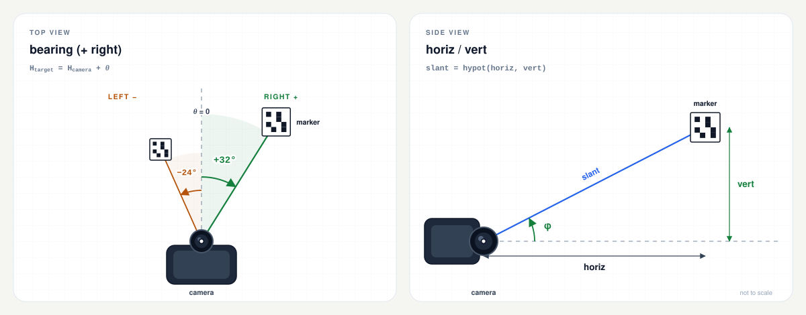

# arucocam

[English](README.md) | [繁體中文](README.zh-TW.md) | [简体中文](README.zh-CN.md) | [Español](README.es.md) | [Русский](README.ru.md)

> 本文件是英文 README 的翻译；如有歧义，以[英文版本](README.md)为准。

一个静态二进制文件，可检测 ArUco 标记，并报告每个标记的方位角、水平距离和垂直偏移。它面向 Raspberry Pi 机器人及其他 Linux 系统：设备上不需要 OpenCV、Python 或配置文件。

```bash
$ arucocam --preset cm3-1280 --device /dev/video0 --json
```

```json
{
  "7": {
    "bearing": 22.6,
    "horiz": 1.23,
    "vert": -0.02
  }
}
```

该示例经过美化排版，以便展示结构。使用 `--json` 时，实际输出为 JSON Lines：每个处理过的帧对应一个紧凑对象，每行一个对象。每个标记以其 ID 作为键：

- `bearing` 是标记相对于摄像头前向轴的夹角，单位为度（右为正，左为负）。
- `horiz` 是到标记的平面距离，单位为米，在摄像头的水平面内测量。
- `vert` 是垂直偏移，单位为米（向上为正，向下为负）。

三维距离为 `hypot(horiz, vert)`。完整约定（包括文本输出和精度）见[输出](#输出)。

[](docs/README.md)

## 目录

- [快速开始](#快速开始)
- [功能特性](#功能特性)
- [支持的目标平台](#支持的目标平台)
- [标记](#标记)
- [标定](#标定)
- [摄像头输入](#摄像头输入)
- [输出](#输出)
- [选项](#选项)
- [故障排查](#故障排查)
- [构建](#构建)
- [测试](#测试)
- [验证发布版本](#验证发布版本)
- [许可证](#许可证)
- [目录结构](#目录结构)

## 快速开始

### 1. 选择二进制文件

| 设备 / 操作系统 | `uname -m` | 发布资源 |
| --- | --- | --- |
| Pi Zero、Zero W、Pi 1（32 位 OS） | `armv6l` | `arucocam-arm32` |
| Pi 3、Pi 4、Pi 5、Zero 2 W、CM4/CM5（64 位 OS） | `aarch64` | `arucocam-arm64` |
| 较新的 Pi，运行 32 位 OS | `armv7l` | `arucocam-arm32` |
| Linux x86-64 | `x86_64` | `arucocam-amd64` |

从[最新发布版本](https://github.com/fernjager/arucocam/releases/latest)下载，并赋予可执行权限：

```bash
ASSET=arucocam-arm64
BASE=https://github.com/fernjager/arucocam/releases/latest/download
wget -O arucocam "$BASE/$ASSET"
chmod +x arucocam
```

根据目标平台修改 `ASSET`。这会将发布资源保存为 `arucocam`。之后若要安装到系统全局，请运行 `sudo install -m 0755 arucocam /usr/local/bin/arucocam`。

`wget` 通常已预装在 Raspberry Pi OS 以及精简/BusyBox 系统中。如果它不存在，或不支持 HTTPS，请改用 `curl -fLo arucocam "$BASE/$ASSET"`。若要先校验下载内容，请参阅[验证发布版本](#验证发布版本)。

### 2. 检查程序能否运行

```bash
./arucocam --version
./arucocam --list-presets
```

`--list-presets` 会打印每个受支持模块的内参和水平视场角。请选择与你的摄像头最接近的预设。

### 3. 对准标记

```bash
# A V4L2 capture device:
./arucocam --preset v2-640 --device /dev/video0 --json

# A libcamera/rpicam producer:
rpicam-vid -t 0 --codec yuv420 --width 640 --height 480 --framerate 15 --inline -o - |
  ./arucocam --preset v2-640 --stdin --json
```

打印一个来自同一字典的标记（默认是 `DICT_4X4_50`），并将 `--marker-size` 设为实测的黑色方块边长（毫米）。默认值为 100 mm。参见[标记](#标记)。

如果 `/dev/video0` 不是你的摄像头，或者你的摄像头只能通过 libcamera 访问，请参阅[摄像头输入](#摄像头输入)。

本 README 的其余部分假定 `arucocam` 已在 `PATH` 中。如果是在本目录运行下载的二进制文件，请使用 `./arucocam`。

## 功能特性

- 针对常见 Raspberry Pi 和 Arducam 摄像头模块，在 640x480、1280x720 和 1920x1080 分辨率下提供[预设标定设置](#预设)。
- 无需配置文件：所有参数都可以在命令行中设置。
- 目标设备上不需要 OpenCV 或 Python 运行时。二进制文件静态链接 musl。
- 支持 V4L2 采集、stdin 流（I420、MJPEG 或原始灰度）以及单张静态图像。
- 为控制器提供紧凑的 JSON Lines，另有人类可读的文本输出和 `--detect-only` 诊断。
- ARMv6 构建固定使用 VFPv2，并检查确认不含 NEON，因此既能在 Pi Zero 和 Pi 1 上运行，也能在较新的 32 位 Raspberry Pi OS 上运行。

## 支持的目标平台

| 目标 | 开发板 / 系统 | 二进制文件 | 构建 |
| --- | --- | --- | --- |
| `armv6` | Pi Zero、Pi Zero W、Pi 1 | `dist/arucocam-arm32` | ARM1176JZF-S、VFPv2，**无 NEON** |
| `arm64` | Pi 3、Pi 4、Pi 5、Zero 2 W、CM4/CM5 | `dist/arucocam-arm64` | ARMv8-A AArch64 |
| `amd64` | Linux x86-64 | `dist/arucocam-amd64` | 通用 x86-64，SSE2 基线 |

这三个二进制文件都是 Linux ELF 可执行文件，静态链接 musl。它们可在未安装 OpenCV 的 glibc 和 musl 发行版上运行。ARMv6 二进制文件也能在较新的 32 位 Raspberry Pi OS 上运行；普通的 armhf 二进制文件可能链接成功，随后却在 ARM1176 上崩溃，因为它含有 NEON 指令。

直接进行 V4L2 采集需要 Linux 和 V4L2 采集设备。在现代 Raspberry Pi OS 上，摄像头栈是 libcamera，因此 stdin 通路通常是用 Pi 摄像头最简单的方式。参见[摄像头输入](#摄像头输入)。

## 标记

`arucocam` 用于检测 ArUco 标记。实用规则如下：

- **字典。** 打印的标记与 `--dict` 必须使用相同的字典。默认是 `DICT_4X4_50`。字典名称不区分大小写。
- **ID。** ID 编码在标记中。使用 `--target-id 7` 可只报告标记 7；不指定时，所有通过位姿门限的标记都会被处理。
- **尺寸。** `--marker-size` 是外侧黑色方块的边长，单位为毫米。它不是纸张尺寸、图像尺寸或白色静区。默认是 100 mm。
- **静区。** 在标记周围保留白色边框。使用 OpenCV 默认 `borderBits=1` 生成的标记自带一个模块宽的边框。
- **打印。** 以 100% / 实际尺寸打印，并用卡尺测量黑色方块。100 mm 标记上 1 mm 的误差会造成 1% 的距离偏差。
- **安装。** 保持标记平整、刚性、无光泽且光照均匀。反光、褶皱和运动模糊会降低位姿精度。检测器只报告位置，不报告标记朝向。

要在工作站上生成标记（目标设备上不需要 OpenCV Python）：

```python
import cv2

dictionary = cv2.aruco.getPredefinedDictionary(cv2.aruco.DICT_4X4_50)
marker = cv2.aruco.generateImageMarker(dictionary, 7, 800)
cv2.imwrite("marker-7.png", marker)
```

以实际尺寸打印 `marker-7.png`。800x800 的图像包含白色边框；请测量比图像小的黑色方块，用于 `--marker-size`。

测试辅助程序 `tests/gen_marker.cpp` 也能将标记渲染到 PGM 画布中，但它只在测试套件中构建，不会被安装。

## 标定

使用预设：

```bash
arucocam --preset fisheye160-640 --device /dev/video0 --json
```

或直接传入内参：

```bash
arucocam --fx 600 --fy 600 --cx 320 --cy 240 \
         --width 640 --height 480 --marker-size 100 --device /dev/video0 --json
```

- 除非使用 `--preset`，否则必须提供 `--fx/--fy`。
- `--cx/--cy` 默认取图像中心。
- `--k1..--k4` 是鱼眼畸变系数；默认为 `0`。
- `--preset` 不能与 `--fx/--fy/--cx/--cy/--k1..--k4` 或 `--width/--height` 同时使用。
- 预设会设置 `--width`、`--height`、`--fx`、`--fy`、`--cx` 和 `--cy`，并将畸变系数设为零。它**不会**设置 `--marker-size`。
- `--marker-size` 是**外侧黑色方块**的边长（毫米），不是纸张或静区尺寸。默认 `100`。
- 采集与标定应使用相同的宽高比；使用相同分辨率最为简单。如果帧尺寸不同但宽高比匹配（误差在 0.5% 以内），内参会按帧尺寸缩放；否则程序会以宽高比不匹配错误退出。

预设只是起点，不是标定。要获得以米为单位的距离，请使用 `cv::fisheye::calibrate` 或棋盘格工具标定 `fx`、`fy`、`cx`、`cy` 和畸变。标定前先对焦，如果模块支持，请锁定自动对焦。

### 预设

名称均为小写且区分大小写，形式为 `<family>-<resolution>`：`-640` 表示 640x480，`-1280` 表示 1280x720，`-1920` 表示 1920x1080。运行 `arucocam --list-presets` 可将这些数值和水平视场角以表格形式打印出来。

| 系列 | 模块 / 光学 | 水平视场角 | 640 / 1280 / 1920 下的 fx=fy | 1 m / 3 m 处 100 mm 标记的像素宽度 |
| --- | --- | ---: | ---: | ---: |
| `v1` | Camera Module V1 / NoIR / Pi Zero 摄像头（OV5647，3.6 mm） | 53.5° | 635 / 1270 / 1905 | 64 / 21 |
| `v2` | Camera Module V2 / NoIR（IMX219，3.04 mm） | 62.2° | 530 / 1061 / 1591 | 53 / 18 |
| `cm3` | Camera Module 3（IMX708，4.74 mm） | 66° | 493 / 985 / 1478 | 49 / 16 |
| `cm3wide` | Camera Module 3 Wide（IMX708，2.75 mm） | 102° | 259 / 518 / 777 | 26 / 9 |
| `aicam` | AI Camera（IMX500，4.74 mm） | 66.3° | 490 / 980 / 1470 | 49 / 16 |
| `imx519` | Arducam 16MP IMX519 自动对焦，标配镜头 | 66° | 493 / 985 / 1478 | 49 / 16 |
| `hawkeye` | Arducam 64MP Hawk-Eye 自动对焦，标配镜头（OV64A40） | 72° | 440 / 881 / 1321 | 44 / 15 |
| `owlsight` | Arducam 64MP OwlSight，6.65 mm 镜头（OV64A40） | 68° | 474 / 949 / 1423 | 47 / 16 |
| `fisheye160` | 160° 对角线 OV5647 鱼眼镜头 | 160° 对角线（≈128° 水平） | 286 / 573 / 860 | 29 / 10 |

完整名称：`v1-640`、`v1-1280`、`v1-1920`，其他系列同理。三种分辨率下的 HFOV 相同，因为它取决于镜头。

Arducam 各行假定使用所列的标配镜头；更换镜头会改变 `fx`。请将它们视为起点，而非标定结果。NoIR 版本与彩色版本使用相同的预设。

标记宽度一列基于 640 px 预设和 100 mm 黑色方块。在 1280 和 1920 下，标记宽度大约分别是两倍和三倍，除非用 `--process-width` 将处理分辨率降回 640。

备注：

- 160° 是鱼眼镜头的**对角线**视场角。16:9 预设会在垂直方向裁切 4:3 传感器，因此其对角线视场角更接近 147°。
- `cm3-640` 和 `cm3wide-640` 预设是近似值，因为这些传感器是 16:9；在 Pi Zero 上建议使用 1280x720 并配合 `--process-width 640`。
- HQ Camera 和 Global Shutter Camera 使用 C/CS 镜头；没有通用预设。请使用 `--fx/--fy` 或进行标定。

如果预设偏差较大，请进行标定，而不是凭肉眼调整 `fx`。

## 摄像头输入

只能选择一个输入源。`--image`、`--stdin` 和 `--device` 互斥；若都未指定，程序会通过 V4L2 打开 `/dev/video0`。

| 输入源 | 适用场景 | 说明 |
| --- | --- | --- |
| `--image PATH` | 单张静态帧 | PGM、PNG 或 JPEG；处理一帧后退出 |
| `--device PATH` | Linux V4L2 采集 | 默认 `/dev/video0`；必须提供受支持的格式 |
| `--stdin` | libcamera/rpicam、GStreamer 或其他进程 | 原始 I420/灰度或 MJPEG；将 `--width/--height` 设为生产者的帧尺寸 |

### V4L2 摄像头

```bash
arucocam --preset fisheye160-640 --device /dev/video0 --json
arucocam --preset fisheye160-1280 --process-width 640 \
         --device /dev/video0 --max-fps 10 --json
```

`--device` 默认为 `/dev/video0`。查找采集节点：

```bash
sudo apt install v4l-utils
v4l2-ctl --list-devices
```

V4L2 通路优先使用直接亮度格式：`GREY`、`YUV420`、`NV12`、`YUYV`、`UYVY`，然后是 `MJPEG`/`JPEG`，最后是 `RGB24`/`BGR24`。Pi 的 `bcm2835-v4l2` 驱动通常提供 YUYV。程序会请求 `--width`/`--height` 指定的大小；如果驱动无法在该尺寸下提供受支持的格式，程序会失败。

`--max-fps` 限制的是**处理**帧率，并会丢弃过期帧；当 CPU 满载时使用 `--max-fps 5`。程序不会设置摄像头帧率，也不会写入摄像头控制项：曝光、增益/ISO、白平衡和帧率保持 `v4l2-ctl` 或驱动所设定的值。某些驱动会在格式变更时重置控制项，因此请在程序运行期间确认这些设置。

如果摄像头只提供 H.264 或其他不受支持的格式，或者只能通过 libcamera 使用，请改用 stdin 通路，并配合一个输出 I420 或 MJPEG 的生产者（例如 `rpicam-vid --codec yuv420`）。

### 标准输入

```bash
rpicam-vid -t 0 --codec yuv420 --width 640 --height 480 --framerate 15 --inline -o - |
  arucocam --preset fisheye160-640 --stdin --json
```

`rpicam-vid` 是 Bookworm 中的名称；较旧的 Bullseye 镜像使用 `libcamera-vid`。`--codec yuv420` 输出原始 I420。对于 MJPEG：

```bash
rpicam-vid -t 0 --codec mjpeg --width 1280 --height 720 --framerate 30 --inline -o - |
  arucocam --preset v2-1280 --stdin --stdin-format mjpeg --json
```

`--stdin-format` 默认为 `auto`：程序会查看前两个字节，若为 JPEG 图像起始标记则按 MJPEG 处理，其他情况按原始 I420 处理。对于原始 8 位灰度，使用 `--stdin-format gray`；若生产者输出 JPEG，则使用 `mjpeg`。可接受的别名有：`mjpeg` 可写作 `jpeg`，`i420` 可写作 `yuv420`/`yuv`，`gray` 可写作 `grey`/`raw`。

原始格式需要 `--width` 和 `--height`；I420 还要求两者均为偶数。对于所有 stdin 输入源，都应将 `--width/--height` 设为生产者的帧尺寸：MJPEG 能自行解析尺寸，但这些标志仍决定标定几何。尺寸不匹配可能导致原始帧失去同步，或触发宽高比错误。

`--frames N` 适合做快速验证；`--max-fps` 可限制处理速度而不改变生产者的帧率。每个解码帧对应一条输出记录，且不附带时间戳。

### 静态图像

```bash
arucocam --preset fisheye160-640 --image frame.pgm --json
arucocam --preset fisheye160-640 --detect-only --image frame.pgm
```

`--image` 接受 PGM、PNG 或 JPEG，并只处理一帧。静态图像默认使用 `--confirm 1`，除非显式指定 `--confirm`。不要在单张图像下传入大于 1 的 `--confirm`：标记永远无法累积足够多的连续帧，因而不会在 **JSON** 输出中被确认（文本输出会立即打印有效位姿）。

图像必须与标定的宽高比匹配（使用完全相同的分辨率最简单）。如果不匹配，程序会报告宽高比不匹配；请使用匹配的预设，或传入图像的 `--width`/`--height` 与内参。

## 输出

### JSON

`--json` 输出 JSON Lines：每个处理过的帧对应一个紧凑对象，后跟换行符并立即刷新。没有外层数组，也没有时间戳。

```json
{"7":{"bearing":2.6,"horiz":1.23,"vert":-0.02},"8":{"bearing":-11.4,"horiz":0.82,"vert":0.03}}
```

- 键是标记 ID 的 JSON 字符串，按升序排序。
- 只包含已**确认**且位姿有效的标记。
- 无标记时为 `{}`（使用 `--timing` 时为 `{"_timing":{...}}`）。
- 多个标记时：每个标记一个键。
- 不输出时间戳；请在控制器收到时自行打时间戳。不包含目标、调试或完整位姿记录。
- `--target-id N` 只过滤输出；检测仍会对所有标记运行。
- `_timing` 是保留键，仅在 `--timing` 时出现。

| 字段 | 单位 | 含义 |
| --- | --- | --- |
| `bearing` | 度 | 右为正（顺时针），−180 到 180 |
| `horiz` | 米 | 摄像头水平面内的平面距离 |
| `vert` | 米 | 垂直偏移，向上为正，相对于摄像头 |

机体坐标系：`x` 向前，`y` 向左，`z` 向上。原点是摄像头的光心。`bearing = 0` 是前向轴，通常是图像中心；经过标定的主点可能略微偏离中心。

报告的方位角采用罗盘式约定，而非机体坐标系中的极角。可用下式重建标记位置：

```text
x       = horiz * cos(bearing)
y_left  = -horiz * sin(bearing)
z       = vert
```

如果摄像头前向轴的罗盘航向为 `H_camera`，则标记的绝对罗盘方位角为：

```text
H_target = H_camera + bearing
```

`vert` 不是离地高度，而是标记相对于摄像头的垂直偏移。真实三维距离为 `hypot(horiz, vert)`。

完整示意图：[俯视图](docs/bearing-top-view.svg) · [侧视图](docs/bearing-side-view.svg) · [几何说明](docs/README.md)。

`--timing` 会为每行 JSON 添加保留键 `_timing`：

```json
{"7":{"bearing":2.6,"horiz":1.23,"vert":-0.02},"_timing":{"processMs":12.345}}
```

`processMs` 是该帧在检测/PnP 上花费的时间，不含 JSON 输出和 `--max-fps` 休眠。只有在显式请求时才会影响 JSON。`--timing` 需要配合 `--json`。

紧凑的二进制传输协议保留给未来版本；目前**尚未**实现。当前稳定的接口是 JSON 字段名和单位。计划中的布局见 [docs/binary-protocol.md](docs/binary-protocol.md)。

### 文本输出

不使用 `--json` 时，输出是人类可读的：

```text
id=7 bearing=+2.6deg horiz=1.23m vert=-0.02m
```

添加 `--verbose` 可显示 RMS 和像素面积：

```text
id=7 bearing=+2.6deg horiz=1.23m vert=-0.02m rms=0.42px area=4096px
```

JSON 会等待 `--confirm` 个连续有效帧。文本输出是诊断流：即使标记尚未确认，也会立即打印位姿有效的标记，因此 `--confirm` 不会延迟文本输出。如果标记被检测到但未通过位姿门限，文本输出会报告，而 JSON 不会：

```text
id=7 detected center=(320.0,240.0) area=1200px rejected rms=8.20px
```

`--detect-only` 跳过 PnP，打印检测到的 ID、像素中心和面积；它仅支持文本输出，不能与 `--json` 组合使用：

```text
id=7 detected center=(320.0,240.0) area=4096px
```

没有可报告的内容时，文本输出会打印 `no markers`。`--verbose` 仅支持文本输出，不能与 `--json` 组合使用。

### 退出状态与信号

- `0`：正常完成，包括 `--help`、`--version`、`--list-presets`、流结束以及未找到标记的运行。
- `1`：选项无效、标定失败、I/O 错误或采集/解码错误。错误消息以 `arucocam: error: ...` 写入 stderr。
- `SIGINT` / `SIGTERM`：处理完当前帧后停止，并以 `0` 退出。
- 单帧 OpenCV 错误会以 `arucocam: frame N: ...` 报告，处理继续进行。

### 精度

数值按 0.1° 和 0.01 m 打印。这是显示分辨率，不是精度。对于在 640 px 下处理的 100 mm 标记，短距离下方位角误差约为 0.1-0.5°，水平/垂直误差为 1-3%，较远距离下为 5-10%；鱼眼预设处于较差的一端。标记黑色方块上 1 mm 的误差会造成 1% 的距离偏差，而预设并不等同于标定。

`--max-rms` 和 `--min-area` 是**处理后**图像中的门限，因此 `--process-width` 会改变它们的实际取值以及报告的 `area`。`--confirm` 只控制 JSON 输出，不会做平均或滤波，文本输出也不会等待它。没有时间平滑。

为获得更好的结果，请标定镜头、使用 `--corner-refine subpix`、让标记在画面中尽量大，并收紧 `--max-rms` / `--min-area`。运动模糊、卷帘快门和掠射视角都会损害位姿精度。请在目标设备上用 `--timing` 实测 `processMs`，而不要从其他机器外推。

## 选项

带值的选项可使用 `--name value` 或 `--name=value` 形式。单个位置参数会被视为 `--image`。

### 输入源

| 选项 | 默认值 | 作用 |
| --- | --- | --- |
| `--image PATH` | — | 单张静态图像（PGM/PNG/JPEG）；处理完即退出。 |
| `--stdin` | 关闭 | 从标准输入读取帧流。 |
| `--stdin-format FMT` | `auto` | `auto`、`mjpeg`、`i420` 或 `gray`（别名见上文）。 |
| `--device PATH` | `/dev/video0` | V4L2 采集设备；在未提供其他输入源时使用。 |
| `--frames N` | `0` | 处理 N 帧后停止；`0` = 直到 EOF 或信号。 |
| `--max-fps N` | `0` | 限制每秒处理帧数；`0` = 不限制。 |

### 内参与标记

| 选项 | 默认值 | 作用 |
| --- | --- | --- |
| `--preset NAME` | — | 常见模块的起始内参；设置 width、height、cx、cy、fx、fy，并将 k1..k4 设为 0。 |
| `--fx`, `--fy` | 除非使用 `--preset`，否则必需 | 焦距（像素）。 |
| `--cx`, `--cy` | width/2、height/2 | 主点（像素）。 |
| `--k1`..`--k4` | `0` | 鱼眼畸变系数。 |
| `--width`, `--height` | `640`、`480` | 采集/标定尺寸；不能与 `--preset` 同用。 |
| `--marker-size MM` | `100` | 外侧黑色方块边长（毫米）。 |
| `--dict NAME` | `DICT_4X4_50` | ArUco 字典；不区分大小写。 |

### 检测

| 选项 | 默认值 | 作用 |
| --- | --- | --- |
| `--process-width N` | `640` | 检测前降采样；`0` = 原始尺寸。从不放大。 |
| `--corner-refine MODE` | `none` | `none`、`subpix`、`contour` 或 `apriltag`。 |
| `--max-rms PX` | `5` | 拒绝重投影 RMS 高于此值（以处理后的像素计）的位姿。 |
| `--min-area PX2` | `50` | 拒绝小于此值（以处理后的像素计）的标记。 |
| `--detect-only` | 关闭 | 跳过 PnP；打印 ID、中心和面积。仅文本。 |
| `--aruco3` | 关闭 | 启用 Aruco3。请先基准测试；在 640x480 下它可能更慢。 |
| `--target-id N` | 全部（`-1`） | 输出过滤；检测仍对每个标记运行。 |
| `--confirm N` | `3` | 标记在 JSON 中被确认前所需的连续有效帧数。文本输出会立即打印有效位姿。静态图像默认为 1。 |

### 输出与通用选项

| 选项 | 默认值 | 作用 |
| --- | --- | --- |
| `--json` | 关闭 | 使用紧凑 JSON Lines 而非文本。 |
| `--verbose` | 关闭 | 在文本输出中加入 RMS/面积；不能与 `--json` 同用。 |
| `--timing` | 关闭 | 添加 `_timing.processMs`；需要 `--json`。 |
| `--list-presets` | — | 打印预设名称、内参和水平视场角。 |
| `--help`, `-h` | — | 打印帮助并退出。 |
| `--version` | — | 打印版本并退出。 |

校验很严格：未知选项、多个输入源、`--preset` 与手动标定或分辨率标志组合、`--detect-only` 与 `--json` 同用、`--verbose` 与 `--json` 同用，以及 `--timing` 缺少 `--json`，都会报错。

### 字典

不区分大小写。支持以下字典：

`DICT_4X4_50`, `DICT_4X4_100`, `DICT_4X4_250`, `DICT_4X4_1000`,
`DICT_5X5_50`, `DICT_5X5_100`, `DICT_5X5_250`, `DICT_5X5_1000`,
`DICT_6X6_50`, `DICT_6X6_100`, `DICT_6X6_250`, `DICT_6X6_1000`,
`DICT_7X7_50`, `DICT_7X7_100`, `DICT_7X7_250`, `DICT_7X7_1000`,
`DICT_ARUCO_ORIGINAL`, `DICT_APRILTAG_16h5`, `DICT_APRILTAG_25h9`,
`DICT_APRILTAG_36h10`, `DICT_APRILTAG_36h11`.

打印的标记与检测器必须使用相同的字典。

## 故障排查

**每帧都是 `{}`。** 没有已确认的有效标记。请检查字典、标记尺寸、对焦、光照，以及 `--preset`/内参是否与采集分辨率匹配。使用 `--detect-only` 查看标记是否至少能被找到。

**每帧都是 `no markers`。** 这是 `{}` 的文本等价形式。如果 `--detect-only` 能找到 ID，而正常输出只显示 `detected ... rejected`，说明位姿被拒绝；请检查 `rejected rms` 的值，并核对 `--max-rms`、`--min-area` 和 `--marker-size`。

**`cannot open /dev/video0` 或权限被拒绝。** 检查 `v4l2-ctl --list-devices`，并确认你的用户可读取该设备。在 Raspberry Pi OS 上：

```bash
sudo usermod -aG video "$USER"
# log out and back in, then retry
```

如果摄像头不是 V4L2 设备，请使用 stdin 通路。

**`no supported V4L2 format`。** 摄像头在请求的尺寸下未提供受支持的原始或 MJPEG 格式。请尝试其他 `--width/--height`，或通过 `--stdin` 从 `rpicam-vid`/`libcamera-vid` 管道传入 I420/MJPEG。

**`--stdin` 没有输出或输出乱码。** 生产者的格式与 `--stdin-format` 不一致，或 `--width/--height` 与帧尺寸不匹配。先从 `--stdin-format auto` 开始，检查生产者的编解码器，并在调试时使用 `--frames 1`。原始 I420 需要偶数尺寸。

**`horiz` 持续偏高或偏低。** 可能是 `--marker-size` 有误，或焦距有误。请测量打印出的黑色方块，而不是纸张。

**`image is ... aspect mismatch`。** 请在采集分辨率下标定，或使用宽高比相同的模式。裁剪会改变 `cx/cy`。

**标记在 JSON 中出现较晚。** 它需要 `--confirm` 个连续有效位姿。文本输出不等待确认。对于单张图像，除非传入 `--confirm`，否则该值自动为 1；使用 `--confirm 3` 的静态图像永远不会出现在 JSON 中。

**JSON 为空，但文本显示有检测结果。** 文本输出包含检测到但被拒绝以及尚未确认的位姿；JSON 只包含已确认且位姿有效的标记。请先检查标记尺寸和标定，再放宽 `--max-rms`/`--min-area`。

**只有靠近时才能检测到标记。** 让标记占据更多像素：提高 `--process-width`（或设为 `0`），降低 `--min-area`，并避免在 Pi Zero 上过度降采样。

**数值在帧之间跳动。** 减少运动模糊、改善光照、使用 `--corner-refine subpix`，并为 JSON 消费方增大 `--confirm`。`--confirm` 只是对噪声帧设门限，不会对它们取平均，文本输出也不会等待它。

**CPU 满载。** 降低 `--process-width`、使用 `--corner-refine none`，并用 `--max-fps 5` 限制处理速度。摄像头帧率通过 `v4l2-ctl --set-parm` 设置（或保持驱动默认值）。`--aruco3` 在较大帧或 Pi Zero 上可能有帮助，但在 QEMU 中 640x480 下更慢；请在目标设备上做基准测试。

**亮度/曝光。** 摄像头图像会被转换为灰度，因此白平衡不影响检测；曝光和 ISO/增益会影响。使用 `v4l2-ctl --list-ctrls` / `--set-ctrl`（必要时加 `--set-parm`），或在管道传输时使用 `rpicam-vid` 的选项。某些驱动会在格式变更时重置控制项，因此请在程序运行期间确认这些设置。

**摄像头被占用。** 另一个进程（包括预览）可能占用了设备。打开 V4L2 节点前请先停止它。

## 构建

构建和检查都在 Docker 中运行；无需宿主机安装 OpenCV 或交叉编译器。你需要带 `buildx` 的 Docker Engine 或 Docker Desktop、用于下载固定版本工具链和 OpenCV 的网络访问，以及足够的磁盘空间来存放构建镜像。构建过程会下载固定版本的预编译 Bootlin Buildroot 工具链压缩包（以 GitHub 发布资源形式镜像），校验其 SHA-256，并为每个目标静态构建 OpenCV 4.14.0。这些工具链是 x86_64 宿主机二进制文件，因此即使在 Apple 芯片上，构建镜像也是 `linux/amd64`；Docker 会对其进行模拟，速度较慢。

```bash
make help               # list targets and current settings

make pi32               # dist/arucocam-arm32    (ARMv6)
make check32            # ELF + functional + preset/dictionary tests

make pi64               # dist/arucocam-arm64    (AArch64)
make check64

make amd64              # dist/arucocam-amd64    (Linux x86-64)
make check-amd64
```

`make pi32` 是默认目标。某个目标的首次构建会编译 OpenCV，可能耗时较长；后续构建会复用 Docker 层。检查在目标镜像内的 QEMU 下运行。构建镜像名为 `arucocam-build:<target>`；`make shell` 可打开它。

其他有用的目标：

```bash
make inspect            # verify the built ELF (static, target ISA)
make tidy               # clang-tidy inside the build image
make clean              # remove build/out and dist
make distclean          # clean + remove the build images
```

GitHub Actions 工作流会构建并测试全部三个目标，并上传 `arucocam-arm32` / `arucocam-arm64` / `arucocam-amd64`；打标签的构建还会发布 `SHA256SUMS`、许可证归档和构建来源信息。`v*` 标签会创建一次发布。

默认构建固定使用 OpenCV 4.14.0、Bootlin Buildroot 2026.08 musl 工具链（GCC 15.3.0、musl 1.2.6）以及固定版本的 `debian:trixie-slim` 基础镜像。Dockerfile 会按 SHA-256 值校验工具链和 OpenCV 下载内容，并通过摘要固定基础镜像。确切的 URL、校验和、基础镜像摘要以及独立验证命令见 [docs/build-provenance.md](docs/build-provenance.md)。

## 测试

`make check32`、`make check64` 和 `make check-amd64` 会构建测试辅助程序，并在 QEMU 下运行：

- 无参数帮助、`--help`、`--version`、`--list-presets`
- 紧凑 JSON 模式和位姿容差
- 方位角符号：中心右侧为正，左侧为负
- 标记尺寸缩放及默认 100 mm
- `--target-id`、空映射、`--detect-only`、`--verbose`
- JSON `--timing.processMs`
- 通过 `--aruco3` 选择性启用 Aruco3
- `--max-fps` 校验
- 多帧 I420/auto-stdin 下的标记确认与丢失
- I420 奇数宽/高的拒绝
- 预设/手动配置冲突的拒绝
- 所有预设在匹配的空白帧上的表现
- 所有文档中列出的字典
- ELF 检查：静态、ARMv6/VFPv2/无 NEON、AArch64 或 x86-64

测试套件是 `tests/test_arucocam.py`，加上辅助脚本 `build/scripts/check.sh`、`build/scripts/check-binary.sh` 和 `tests/gen_marker.cpp`；不需要摄像头硬件。`make tidy` 会在构建镜像内运行 clang-tidy。

## 验证发布版本

每个 `v*` 发布都会提供三个二进制文件、`SHA256SUMS` 和 `arucocam-licenses.tar.gz`（其中包含 `LICENSE`、`THIRD_PARTY_NOTICES.md` 和 `LICENSES/`）。它还附带 GitHub 构建来源证明。以下命令以发布时的名称下载资源，以便 `SHA256SUMS` 直接匹配。

```bash
ASSET=arucocam-arm64
BASE=https://github.com/fernjager/arucocam/releases/latest/download
wget -O "$ASSET" "$BASE/$ASSET"
wget -O SHA256SUMS "$BASE/SHA256SUMS"
sha256sum -c --ignore-missing SHA256SUMS

# Optional: verify the artifact attestation (requires the GitHub CLI)
gh attestation verify "$ASSET" --repo fernjager/arucocam
```

确切的工具链和 OpenCV 版本固定值，以及自行校验上游压缩包的命令，见 [docs/build-provenance.md](docs/build-provenance.md)。

## 许可证

MIT。参见 [LICENSE](LICENSE)。预编译二进制文件还包含第三方组件；参见 [THIRD_PARTY_NOTICES.md](THIRD_PARTY_NOTICES.md)。

## 目录结构

```text
arucocam/
├── CMakeLists.txt
├── Makefile                    # image / pi32 / pi64 / amd64 / checks
├── build/
│   ├── docker/Dockerfile       # target-aware musl toolchain + static OpenCV
│   ├── cmake/toolchain/        # ARMv6, AArch64, and x86-64 toolchains
│   ├── scripts/                # build, check, ELF-check, tidy helpers
│   └── out/                    # generated per-target CMake build trees
├── dist/                       # generated release binaries
├── docs/
│   ├── README.md               # geometry notes and convention details
│   ├── binary-protocol.md      # reserved future binary transport
│   ├── build-provenance.md     # pinned toolchains, OpenCV, and checksums
│   ├── gen_bearing_diagrams.py
│   ├── bearing-compact.*       # two-panel README banner
│   ├── bearing-top-view.*      # full top view
│   └── bearing-side-view.*     # full side view
├── src/
│   ├── main.cpp                # CLI and frame loop
│   ├── calibration.*           # intrinsics and validation
│   ├── detector.*              # ArUco, fisheye PnP, confirmation
│   ├── frame_source.*          # image / stdin I420 / MJPEG
│   ├── v4l2_source.*           # Linux V4L2 mmap capture
│   └── output.*                # compact JSON and text
├── tests/
│   ├── gen_marker.cpp          # synthetic marker image
│   └── test_arucocam.py        # functional tests under qemu
├── .clang-format
├── .clang-tidy
├── .editorconfig
├── .github/workflows/ci.yml    # ARMv6 + ARM64 + x86-64 builds/releases
├── LICENSE
├── LICENSES/                   # third-party license texts
├── README.es.md                # Spanish translation
├── README.md
├── README.ru.md                # Russian translation
├── README.zh-CN.md             # Simplified Chinese translation
├── README.zh-TW.md             # Traditional Chinese translation
└── THIRD_PARTY_NOTICES.md
```
