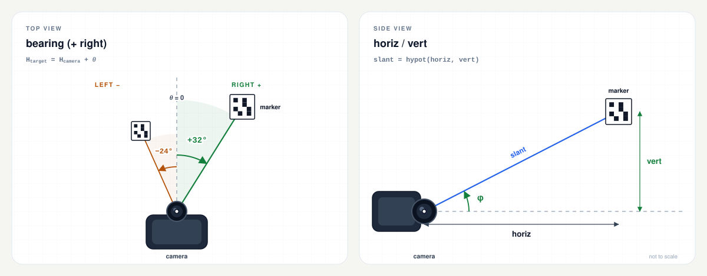

# arucocam

[English](README.md) | [繁體中文](README.zh-TW.md) | [简体中文](README.zh-CN.md) | [Español](README.es.md) | [Русский](README.ru.md)

> 本文件是英文 README 的翻譯；如有歧義，以[英文版本](README.md)為準。

單一靜態二進位檔，可偵測 ArUco 標記，並回報每個標記的方位角、水平距離與垂直偏移。它針對 Raspberry Pi 機器人與其他 Linux 系統設計：裝置上不需要 OpenCV、Python 或設定檔。

```bash
$ arucocam --preset cm3-1280 --device /dev/video0 --json
```

```json
{
  "7": {
    "bearing": 22.6,
    "horiz": 1.23,
    "vert": -0.02
  }
}
```

此範例經過美化排版以呈現結構。使用 `--json` 時，實際輸出為 JSON Lines：每個處理過的影格一個精簡物件，每行一個物件。每個標記以其 ID 作為鍵值：

- `bearing` 是標記相對於相機前向軸的角度，單位為度（右正、左負）。
- `horiz` 是到標記的平面距離，單位為公尺，在相機的水平面上量測。
- `vert` 是垂直偏移，單位為公尺（上正、下負）。

三維距離為 `hypot(horiz, vert)`。完整的輸出約定（包含文字輸出與精度）請參閱[輸出](#輸出)。

[](docs/README.md)

## 目錄

- [快速開始](#快速開始)
- [功能特色](#功能特色)
- [支援目標](#支援目標)
- [標記](#標記)
- [校正](#校正)
- [相機輸入](#相機輸入)
- [輸出](#輸出)
- [選項](#選項)
- [疑難排解](#疑難排解)
- [建置](#建置)
- [測試](#測試)
- [驗證發行版](#驗證發行版)
- [授權](#授權)
- [目錄結構](#目錄結構)

## 快速開始

### 1. 選擇二進位檔

| 裝置 / 作業系統 | `uname -m` | 發行版資產 |
| --- | --- | --- |
| Pi Zero、Zero W、Pi 1（32 位元 OS） | `armv6l` | `arucocam-arm32` |
| Pi 3、Pi 4、Pi 5、Zero 2 W、CM4/CM5（64 位元 OS） | `aarch64` | `arucocam-arm64` |
| 較新的 Pi 搭配 32 位元 OS | `armv7l` | `arucocam-arm32` |
| Linux x86-64 | `x86_64` | `arucocam-amd64` |

從[最新發行版](https://github.com/fernjager/arucocam/releases/latest)下載，並使其可執行：

```bash
ASSET=arucocam-arm64
BASE=https://github.com/fernjager/arucocam/releases/latest/download
wget -O arucocam "$BASE/$ASSET"
chmod +x arucocam
```

請依目標變更 `ASSET`。這會將發行版資產儲存為 `arucocam`。之後若要安裝到全系統，請執行 `sudo install -m 0755 arucocam /usr/local/bin/arucocam`。

`wget` 通常內建於 Raspberry Pi OS 與精簡/BusyBox 系統。若系統缺少它，或其 HTTPS 支援不可用，請改用 `curl -fLo arucocam "$BASE/$ASSET"`。若要先驗證下載內容，請參閱[驗證發行版](#驗證發行版)。

### 2. 確認可執行

```bash
./arucocam --version
./arucocam --list-presets
```

`--list-presets` 會印出每個支援模組的內參與水平視野。請選擇最接近您相機的預設集。

### 3. 對準標記

```bash
# A V4L2 capture device:
./arucocam --preset v2-640 --device /dev/video0 --json

# A libcamera/rpicam producer:
rpicam-vid -t 0 --codec yuv420 --width 640 --height 480 --framerate 15 --inline -o - |
  ./arucocam --preset v2-640 --stdin --json
```

請列印來自同一字典的標記（預設為 `DICT_4X4_50`），並將 `--marker-size` 設為量測到的黑色方塊寬度，單位為公釐。預設值為 100 mm。請參閱[標記](#標記)。

若 `/dev/video0` 不是您的相機，或相機僅能透過 libcamera 使用，請參閱[相機輸入](#相機輸入)。

本 README 其餘部分假設 `arucocam` 已在 `PATH` 中。若在此目錄執行下載的二進位檔，請使用 `./arucocam`。

## 功能特色

- 針對常見 Raspberry Pi 與 Arducam 相機模組，提供 640x480、1280x720 與 1920x1080 的[預設校正設定](#預設集)。
- 無需設定檔：所有參數都可透過命令列設定。
- 目標裝置上不需要 OpenCV 或 Python 執行環境。二進位檔以 musl 靜態連結。
- 支援 V4L2 擷取、標準輸入串流（I420、MJPEG 或原始灰階），以及單張靜態影像。
- 為控制器提供精簡的 JSON Lines，另有易讀的文字輸出與 `--detect-only` 診斷。
- ARMv6 建置固定使用 VFPv2，並檢查不含 NEON，因此可在 Pi Zero、Pi 1 以及較新的 32 位元 Raspberry Pi OS 上執行。

## 支援目標

| 目標 | 開發板 / 系統 | 二進位檔 | 建置 |
| --- | --- | --- | --- |
| `armv6` | Pi Zero、Pi Zero W、Pi 1 | `dist/arucocam-arm32` | ARM1176JZF-S、VFPv2、**無 NEON** |
| `arm64` | Pi 3、Pi 4、Pi 5、Zero 2 W、CM4/CM5 | `dist/arucocam-arm64` | ARMv8-A AArch64 |
| `amd64` | Linux x86-64 | `dist/arucocam-amd64` | 一般 x86-64，SSE2 基準 |

三個二進位檔都是 Linux ELF 執行檔，以 musl 靜態連結。它們可在未安裝 OpenCV 的 glibc 與 musl 發行版上執行。ARMv6 二進位檔也能在較新的 32 位元 Raspberry Pi OS 上執行；一般的 armhf 二進位檔雖可連結，但可能因為包含 NEON 指令而在 ARM1176 上執行失敗。

直接 V4L2 擷取需要 Linux 與 V4L2 擷取裝置。在現代 Raspberry Pi OS 上，相機堆疊為 libcamera，因此標準輸入路徑通常是使用 Pi 相機最簡單的方式。請參閱[相機輸入](#相機輸入)。

## 標記

`arucocam` 可偵測 ArUco 標記。實用規則如下：

- **字典。** 列印的標記與 `--dict` 必須使用相同的字典。預設為 `DICT_4X4_50`。字典名稱不分大小寫。
- **ID。** ID 編碼於標記中。使用 `--target-id 7` 只回報標記 7；若不指定，則會處理每個通過姿態閘門的標記。
- **尺寸。** `--marker-size` 是外側黑色方塊的邊長，單位為公釐。它不是紙張尺寸、影像尺寸或白色靜區。預設值為 100 mm。
- **靜區。** 標記周圍需保留白色邊框。使用 OpenCV 預設 `borderBits=1` 產生的標記會包含一個模組寬的邊框。
- **列印。** 以 100% / 實際大小列印，並用游標卡尺量測黑色方塊。100 mm 標記上 1 mm 的誤差會造成 1% 的距離偏差。
- **安裝。** 標記應保持平整、堅固、霧面且受光均勻。反光、皺褶與動態模糊會降低姿態精度。偵測器不會回報標記方向，只回報位置。

若要在工作站產生標記（目標裝置不需要 OpenCV Python）：

```python
import cv2

dictionary = cv2.aruco.getPredefinedDictionary(cv2.aruco.DICT_4X4_50)
marker = cv2.aruco.generateImageMarker(dictionary, 7, 800)
cv2.imwrite("marker-7.png", marker)
```

以實際大小列印 `marker-7.png`。800x800 影像包含白色邊框；請量測比影像小的黑色方塊，作為 `--marker-size`。

測試輔助程式 `tests/gen_marker.cpp` 也能將標記繪製到 PGM 畫布，但它只隨測試套件建置，不會安裝。

## 校正

使用預設集：

```bash
arucocam --preset fisheye160-640 --device /dev/video0 --json
```

或直接傳入內參：

```bash
arucocam --fx 600 --fy 600 --cx 320 --cy 240 \
         --width 640 --height 480 --marker-size 100 --device /dev/video0 --json
```

- 除非使用 `--preset`，否則必須提供 `--fx/--fy`。
- `--cx/--cy` 預設為影像中心。
- `--k1..--k4` 是魚眼畸變係數；預設為 `0`。
- `--preset` 不能與 `--fx/--fy/--cx/--cy/--k1..--k4` 或 `--width/--height` 合併使用。
- 預設集會設定 `--width`、`--height`、`--fx`、`--fy`、`--cx` 與 `--cy`，並將畸變係數設為零。它**不會**設定 `--marker-size`。
- `--marker-size` 是**外側黑色方塊**的尺寸，單位為公釐，不是紙張或靜區尺寸。預設為 `100`。
- 擷取與校正應使用相同長寬比；使用相同解析度最為簡單。若影格尺寸不同但長寬比相符（誤差在 0.5% 以內），內參會縮放至該影格；否則程式會以長寬比不符錯誤結束。

預設集只是起點，不是校正。若要取得公制距離，請使用 `cv::fisheye::calibrate` 或棋盤格工具校正 `fx`、`fy`、`cx`、`cy` 與畸變。校正前請先對焦；若模組支援，請鎖定自動對焦。

### 預設集

名稱皆為小寫且區分大小寫，格式為 `<family>-<resolution>`：`-640` 是 640x480，`-1280` 是 1280x720，`-1920` 是 1920x1080。執行 `arucocam --list-presets` 可將這些數值與水平 FOV 以表格印出。

| 系列 | 模組 / 光學 | 水平 FOV | 640 / 1280 / 1920 時的 fx=fy | 1 m / 3 m 處 100 mm 標記的像素寬 |
| --- | --- | ---: | ---: | ---: |
| `v1` | Camera Module V1 / NoIR / Pi Zero 相機（OV5647，3.6 mm） | 53.5° | 635 / 1270 / 1905 | 64 / 21 |
| `v2` | Camera Module V2 / NoIR（IMX219，3.04 mm） | 62.2° | 530 / 1061 / 1591 | 53 / 18 |
| `cm3` | Camera Module 3（IMX708，4.74 mm） | 66° | 493 / 985 / 1478 | 49 / 16 |
| `cm3wide` | Camera Module 3 Wide（IMX708，2.75 mm） | 102° | 259 / 518 / 777 | 26 / 9 |
| `aicam` | AI Camera（IMX500，4.74 mm） | 66.3° | 490 / 980 / 1470 | 49 / 16 |
| `imx519` | Arducam 16MP IMX519 自動對焦，原廠鏡頭 | 66° | 493 / 985 / 1478 | 49 / 16 |
| `hawkeye` | Arducam 64MP Hawk-Eye 自動對焦，原廠鏡頭（OV64A40） | 72° | 440 / 881 / 1321 | 44 / 15 |
| `owlsight` | Arducam 64MP OwlSight，6.65 mm 鏡頭（OV64A40） | 68° | 474 / 949 / 1423 | 47 / 16 |
| `fisheye160` | 160° 對角線 OV5647 魚眼 | 160° 對角（水平約 128°） | 286 / 573 / 860 | 29 / 10 |

完整名稱：`v1-640`、`v1-1280`、`v1-1920`，其他系列依此類推。三種解析度的 HFOV 都相同，因為它取決於鏡頭。

Arducam 各列假設使用所列的原廠鏡頭；更換鏡頭會改變 `fx`。請將它們視為起點，而非校正結果。NoIR 版本與彩色版本使用相同的預設集。

標記寬度欄位使用 640 px 預設集與 100 mm 黑色方塊。在 1280 與 1920 下，標記寬度大約分別為兩倍與三倍，除非 `--process-width` 將處理尺寸降回 640。

注意事項：

- 160° 是魚眼的**對角線** FOV。16:9 預設集會從 4:3 感光元件垂直裁切，因此其對角線 FOV 較接近 147°。
- `cm3-640` 與 `cm3wide-640` 預設集為近似值，因為這些感光元件是 16:9；在 Pi Zero 上建議使用 1280x720 搭配 `--process-width 640`。
- HQ Camera 與 Global Shutter Camera 使用 C/CS 鏡頭；沒有通用預設集。請使用 `--fx/--fy` 或進行校正。

若預設集偏差過大，請進行校正，而不是憑目測調整 `fx`。

## 相機輸入

請只選擇一個來源。`--image`、`--stdin` 與 `--device` 互斥；若都未指定，程式會透過 V4L2 開啟 `/dev/video0`。

| 來源 | 適用情境 | 備註 |
| --- | --- | --- |
| `--image PATH` | 單張靜態影格 | PGM、PNG 或 JPEG；處理一個影格後結束 |
| `--device PATH` | Linux V4L2 擷取 | 預設 `/dev/video0`；必須提供支援的格式 |
| `--stdin` | libcamera/rpicam、GStreamer 或其他程序 | 原始 I420/灰階或 MJPEG；請將 `--width/--height` 設為產生端的影格尺寸 |

### V4L2 相機

```bash
arucocam --preset fisheye160-640 --device /dev/video0 --json
arucocam --preset fisheye160-1280 --process-width 640 \
         --device /dev/video0 --max-fps 10 --json
```

`--device` 預設為 `/dev/video0`。可使用以下指令尋找擷取節點：

```bash
sudo apt install v4l-utils
v4l2-ctl --list-devices
```

V4L2 路徑優先使用直接亮度格式：`GREY`、`YUV420`、`NV12`、`YUYV`、`UYVY`，其次是 `MJPEG`/`JPEG`，最後是 `RGB24`/`BGR24`。YUYV 是 Pi `bcm2835-v4l2` 驅動程式通常提供的格式。程式會要求 `--width`/`--height` 指定的尺寸；若驅動程式無法在該尺寸提供支援的格式，程式會失敗。

`--max-fps` 會限制**處理**速率並捨棄過期影格；當 CPU 滿載時可使用 `--max-fps 5`。程式不會設定相機影格率，也不會寫入相機控制項：曝光、增益/ISO、白平衡與影格率會維持 `v4l2-ctl` 或驅動程式所設定的狀態。部分驅動程式會在格式變更時重設控制項，因此請在程式執行期間確認這些設定。

若相機只提供 H.264 或其他不支援的格式，或僅能透過 libcamera 使用，請改用標準輸入路徑，並搭配可輸出 I420 或 MJPEG 的產生端（例如 `rpicam-vid --codec yuv420`）。

### 標準輸入

```bash
rpicam-vid -t 0 --codec yuv420 --width 640 --height 480 --framerate 15 --inline -o - |
  arucocam --preset fisheye160-640 --stdin --json
```

`rpicam-vid` 是 Bookworm 的名稱；較舊的 Bullseye 映像檔使用 `libcamera-vid`。`--codec yuv420` 會產生原始 I420。若要使用 MJPEG：

```bash
rpicam-vid -t 0 --codec mjpeg --width 1280 --height 720 --framerate 30 --inline -o - |
  arucocam --preset v2-1280 --stdin --stdin-format mjpeg --json
```

`--stdin-format` 預設為 `auto`：程式會查看前兩個位元組，將 JPEG 影像起始標記視為 MJPEG，其他則視為原始 I420。若為原始 8 位元灰階，請使用 `--stdin-format gray`；若產生端輸出 JPEG，請使用 `mjpeg`。可接受的別名：以 `jpeg` 代表 `mjpeg`、以 `yuv420`/`yuv` 代表 `i420`、以 `grey`/`raw` 代表 `gray`。

原始格式需要 `--width` 與 `--height`；I420 還要求兩者皆為偶數。對每個標準輸入來源，請將 `--width/--height` 設為產生端的影格尺寸：MJPEG 可自行解碼尺寸，但這些旗標仍定義校正幾何。不一致可能導致原始影格失去同步，或觸發長寬比錯誤。

`--frames N` 適合用於快速驗證，而 `--max-fps` 會限制處理速率，但不改變產生端的影格率。每個解碼影格會有一筆輸出記錄；不會附加時間戳。

### 靜態影像

```bash
arucocam --preset fisheye160-640 --image frame.pgm --json
arucocam --preset fisheye160-640 --detect-only --image frame.pgm
```

`--image` 接受 PGM、PNG 或 JPEG，並處理單一影格。靜態影像預設為 `--confirm 1`，除非明確指定 `--confirm`。單一影像請勿傳入大於 1 的 `--confirm`：標記永遠無法累積足夠的連續影格而在 **JSON** 輸出中獲得確認（文字輸出會立即印出有效姿態）。

影像必須符合校正的長寬比（使用完全相同的解析度最簡單）。若不符合，程式會回報長寬比不符；請使用相符的預設集，或傳入影像的 `--width`/`--height` 與內參。

## 輸出

### JSON

`--json` 會輸出 JSON Lines：每個處理過的影格一個精簡物件，後接換行並立即刷新。沒有外層陣列，也沒有時間戳。

```json
{"7":{"bearing":2.6,"horiz":1.23,"vert":-0.02},"8":{"bearing":-11.4,"horiz":0.82,"vert":0.03}}
```

- 鍵值為標記 ID 的 JSON 字串，依遞增排序。
- 只包含**已確認**且具有有效姿態的標記。
- 無標記：`{}`（或搭配 `--timing` 時為 `{"_timing":{...}}`）。
- 多個標記：每個標記一個鍵值。
- 不會輸出時間戳；請在控制器收到時加上時間戳。不會有目標、除錯或完整姿態記錄。
- `--target-id N` 會過濾輸出；偵測仍會對所有標記執行。
- `_timing` 是保留鍵值，僅在指定 `--timing` 時出現。

| 欄位 | 單位 | 意義 |
| --- | --- | --- |
| `bearing` | 度 | 右為正（順時針），−180 至 180 |
| `horiz` | 公尺 | 相機水平面上的平面距離 |
| `vert` | 公尺 | 相對於相機的垂直偏移，上為正 |

機體座標系：`x` 向前、`y` 向左、`z` 向上。原點為相機光心。`bearing = 0` 是前向軸，通常為影像中心；經校正的主點可能略微偏離中心。

回報的方位角採用羅盤式定義，而非機體座標系的極角。可使用以下公式重建標記位置：

```text
x       = horiz * cos(bearing)
y_left  = -horiz * sin(bearing)
z       = vert
```

若相機前向軸的羅盤航向為 `H_camera`，則標記的絕對羅盤方位角為：

```text
H_target = H_camera + bearing
```

`vert` 不是離地高度，而是標記相對於相機的垂直偏移。真正的三維距離是 `hypot(horiz, vert)`。

完整圖示：[俯視圖](docs/bearing-top-view.svg) · [側視圖](docs/bearing-side-view.svg) · [幾何說明](docs/README.md)。

`--timing` 會在每行 JSON 中加入保留的 `_timing` 鍵值：

```json
{"7":{"bearing":2.6,"horiz":1.23,"vert":-0.02},"_timing":{"processMs":12.345}}
```

`processMs` 是該影格用於偵測/PnP 的時間，不包含 JSON 輸出與 `--max-fps` 的休眠。只有在明確要求時才會影響 JSON。`--timing` 需要搭配 `--json`。

精簡的二進位傳輸格式保留給未來版本；目前**尚未**實作。JSON 欄位名稱與單位是目前穩定的介面。預定配置請參閱 [docs/binary-protocol.md](docs/binary-protocol.md)。

### 文字輸出

未使用 `--json` 時，輸出為易讀文字：

```text
id=7 bearing=+2.6deg horiz=1.23m vert=-0.02m
```

加上 `--verbose` 可顯示 RMS 與像素面積：

```text
id=7 bearing=+2.6deg horiz=1.23m vert=-0.02m rms=0.42px area=4096px
```

JSON 會等待 `--confirm` 個連續有效影格。文字輸出是診斷串流：它會立即印出姿態有效的標記，即使尚未確認，因此 `--confirm` 不會延遲文字輸出。若標記被偵測到但未通過姿態閘門，文字輸出會回報；JSON 則不會：

```text
id=7 detected center=(320.0,240.0) area=1200px rejected rms=8.20px
```

`--detect-only` 會略過 PnP，並印出偵測到的 ID、像素中心與面積；它僅限文字輸出，不能與 `--json` 合併使用：

```text
id=7 detected center=(320.0,240.0) area=4096px
```

沒有可回報的內容時，文字輸出會印出 `no markers`。`--verbose` 僅限文字輸出，不能與 `--json` 合併使用。

### 結束狀態與訊號

- `0`：正常完成，包括 `--help`、`--version`、`--list-presets`、串流結束，以及執行後未找到標記。
- `1`：無效選項、校正失敗、I/O 錯誤，或擷取/解碼錯誤。訊息會以 `arucocam: error: ...` 寫入 stderr。
- `SIGINT` / `SIGTERM`：在目前影格處理完後停止，並以 `0` 結束。
- 單一影格的 OpenCV 錯誤會以 `arucocam: frame N: ...` 回報，並繼續處理。

### 精度

數值會印至 0.1° 與 0.01 m。這是顯示解析度，不是準確度。以 640 px 處理 100 mm 標記時，短距離下的方位角誤差約為 0.1-0.5°，水平/垂直誤差約為 1-3%，較長距離則為 5-10%；魚眼預設集屬於誤差較大的一端。標記黑色方塊上 1 mm 的誤差會造成 1% 的距離偏差，而預設集並不是校正。

`--max-rms` 與 `--min-area` 是**處理後**影像中的閘門，因此 `--process-width` 會改變其實際值與回報的 `area`。`--confirm` 是 JSON 輸出的閘門；它不會取平均或濾波，文字輸出也不會等待它。沒有時間平滑處理。

若要獲得更好的結果，請校正鏡頭、使用 `--corner-refine subpix`、讓標記在影格中保持較大，並收緊 `--max-rms` / `--min-area`。動態模糊、滾動快門與掠射視角都會損害姿態準確度。請在目標裝置上使用 `--timing` 量測 `processMs`，而不是從其他機器推算。

## 選項

需要值的選項接受 `--name value` 或 `--name=value`。單一位置參數會視為 `--image`。

### 來源

| 選項 | 預設值 | 效果 |
| --- | --- | --- |
| `--image PATH` | — | 單張靜態影像（PGM/PNG/JPEG）；處理後結束。 |
| `--stdin` | 關閉 | 從標準輸入讀取影格串流。 |
| `--stdin-format FMT` | `auto` | `auto`、`mjpeg`、`i420` 或 `gray`（別名如上）。 |
| `--device PATH` | `/dev/video0` | V4L2 擷取裝置；未指定其他來源時使用。 |
| `--frames N` | `0` | 處理 N 個影格後停止；`0` = 直到 EOF 或訊號。 |
| `--max-fps N` | `0` | 限制每秒處理影格數；`0` = 無限制。 |

### 內參與標記

| 選項 | 預設值 | 效果 |
| --- | --- | --- |
| `--preset NAME` | — | 常見模組的起始內參；會設定 width、height、cx、cy、fx、fy，並將 k1..k4 設為 0。 |
| `--fx`, `--fy` | 除非使用 `--preset`，否則必填 | 焦距，單位為像素。 |
| `--cx`, `--cy` | width/2、height/2 | 主點，單位為像素。 |
| `--k1`..`--k4` | `0` | 魚眼畸變係數。 |
| `--width`, `--height` | `640`, `480` | 擷取/校正尺寸；不能與 `--preset` 併用。 |
| `--marker-size MM` | `100` | 外側黑色方塊，單位為公釐。 |
| `--dict NAME` | `DICT_4X4_50` | ArUco 字典；不分大小寫。 |

### 偵測

| 選項 | 預設值 | 效果 |
| --- | --- | --- |
| `--process-width N` | `640` | 偵測前縮小；`0` = 原始尺寸。永不放大。 |
| `--corner-refine MODE` | `none` | `none`、`subpix`、`contour` 或 `apriltag`。 |
| `--max-rms PX` | `5` | 拒絕重投影 RMS 高於此值的姿態，單位為處理後像素。 |
| `--min-area PX2` | `50` | 拒絕小於此值的標記，單位為處理後像素。 |
| `--detect-only` | 關閉 | 略過 PnP；印出 ID、中心與面積。僅限文字輸出。 |
| `--aruco3` | 關閉 | 啟用 Aruco3。請先進行基準測試；在 640x480 下可能較慢。 |
| `--target-id N` | 全部（`-1`） | 輸出過濾；偵測仍會對每個標記執行。 |
| `--confirm N` | `3` | 在 JSON 中確認標記前所需的連續有效影格數。文字輸出會立即印出有效姿態。靜態影像預設為 1。 |

### 輸出與一般選項

| 選項 | 預設值 | 效果 |
| --- | --- | --- |
| `--json` | 關閉 | 以精簡 JSON Lines 取代文字輸出。 |
| `--verbose` | 關閉 | 在文字輸出中加入 RMS/面積；不能與 `--json` 併用。 |
| `--timing` | 關閉 | 加入 `_timing.processMs`；需要 `--json`。 |
| `--list-presets` | — | 印出預設集名稱、內參與水平 FOV。 |
| `--help`, `-h` | — | 印出說明並結束。 |
| `--version` | — | 印出版本並結束。 |

驗證相當嚴格：未知選項、多重來源、`--preset` 與手動校正或解析度旗標併用、`--detect-only` 搭配 `--json`、`--verbose` 搭配 `--json`，以及 `--timing` 未搭配 `--json`，都會視為錯誤。

### 字典

不分大小寫。支援：

`DICT_4X4_50`, `DICT_4X4_100`, `DICT_4X4_250`, `DICT_4X4_1000`,
`DICT_5X5_50`, `DICT_5X5_100`, `DICT_5X5_250`, `DICT_5X5_1000`,
`DICT_6X6_50`, `DICT_6X6_100`, `DICT_6X6_250`, `DICT_6X6_1000`,
`DICT_7X7_50`, `DICT_7X7_100`, `DICT_7X7_250`, `DICT_7X7_1000`,
`DICT_ARUCO_ORIGINAL`, `DICT_APRILTAG_16h5`, `DICT_APRILTAG_25h9`,
`DICT_APRILTAG_36h10`, `DICT_APRILTAG_36h11`.

列印的標記與偵測器必須使用相同的字典。

## 疑難排解

**每個影格都是 `{}`。** 沒有已確認的有效標記。請檢查字典、標記尺寸、對焦、光線，以及 `--preset`/內參是否符合擷取解析度。使用 `--detect-only` 查看標記是否完全找不到。

**每個影格都是 `no markers`。** 這是 `{}` 的文字版本。若 `--detect-only` 找到 ID，但一般輸出只顯示 `detected ... rejected`，表示姿態被拒絕；請檢查 `rejected rms` 值，並確認 `--max-rms`、`--min-area` 與 `--marker-size`。

**`cannot open /dev/video0` 或權限不足。** 請檢查 `v4l2-ctl --list-devices`，並確認您的使用者可讀取該裝置。在 Raspberry Pi OS 上：

```bash
sudo usermod -aG video "$USER"
# log out and back in, then retry
```

若相機不是 V4L2 裝置，請使用標準輸入路徑。

**`no supported V4L2 format`。** 相機未在要求的尺寸下提供支援的原始或 MJPEG 格式。請嘗試不同的 `--width/--height`，或從 `rpicam-vid`/`libcamera-vid` 將 I420/MJPEG 管線傳入 `--stdin`。

**`--stdin` 沒有輸出或輸出亂碼。** 產生端的格式與 `--stdin-format` 不一致，或 `--width/--height` 與影格尺寸不符。請先使用 `--stdin-format auto`、檢查產生端的編解碼器，並在除錯時使用 `--frames 1`。原始 I420 需要偶數尺寸。

**Horiz 持續偏高或偏低。** 可能是 `--marker-size` 錯誤，或焦距錯誤。請量測列印出的黑色方塊，而不是紙張。

**`image is ... aspect mismatch`。** 請以擷取解析度進行校正，或使用相同長寬比的模式。裁切會改變 `cx/cy`。

**標記較晚才出現在 JSON 中。** 它需要 `--confirm` 個連續有效姿態。文字輸出不會等待確認。對單一影像而言，除非傳入 `--confirm`，否則會自動設為 1；使用 `--confirm 3` 的靜態影像永遠不會出現在 JSON 中。

**JSON 為空，但文字顯示有偵測結果。** 文字輸出包含已偵測但被拒絕，以及尚未確認的姿態；JSON 只包含已確認且姿態有效的標記。請先檢查標記尺寸與校正，再放寬 `--max-rms`/`--min-area`。

**標記只有在近距離時才被偵測到。** 讓標記佔用更多像素：提高 `--process-width`（或使用 `0`）、降低 `--min-area`，並避免在 Pi Zero 上進行過度縮小。

**數值在影格之間跳動。** 減少動態模糊、改善光線、使用 `--corner-refine subpix`，並為 JSON 使用端提高 `--confirm`。`--confirm` 會擋掉雜訊影格；它不會對影格取平均，文字輸出也不會等待它。

**CPU 滿載。** 降低 `--process-width`、使用 `--corner-refine none`，並以 `--max-fps 5` 限制處理。相機速率可透過 `v4l2-ctl --set-parm` 設定（或維持驅動程式預設值）。`--aruco3` 在較大影格或 Pi Zero 上可能有幫助，但在 QEMU 的 640x480 下較慢；請在目標裝置上進行基準測試。

**亮度/曝光。** 相機會轉為灰階，因此白平衡不影響偵測；曝光與 ISO/增益則會影響。請使用 `v4l2-ctl --list-ctrls` / `--set-ctrl`（必要時加上 `--set-parm`），或在管線傳輸時使用 `rpicam-vid` 選項。部分驅動程式會在格式變更時重設控制項，因此請在程式執行期間確認這些設定。

**相機忙碌中。** 其他程序（包括預覽）可能佔用裝置。請先停止該程序，再開啟 V4L2 節點。

## 建置

建置與檢查都在 Docker 中執行；主機不需要 OpenCV 或交叉編譯器。您需要具備 `buildx` 的 Docker Engine 或 Docker Desktop、可下載固定版本工具鏈與 OpenCV 的網路存取，以及足夠的磁碟空間來存放建置映像檔。建置流程會下載固定版本的 Bootlin Buildroot 預建工具鏈壓縮檔（以 GitHub 發行版資產形式提供鏡像）、驗證其 SHA-256，並為每個目標靜態建置 OpenCV 4.14.0。這些工具鏈是 x86_64 主機二進位檔，因此即使在 Apple 晶片上，建置映像檔仍是 `linux/amd64`；Docker 會模擬執行，速度較慢。

```bash
make help               # list targets and current settings

make pi32               # dist/arucocam-arm32    (ARMv6)
make check32            # ELF + functional + preset/dictionary tests

make pi64               # dist/arucocam-arm64    (AArch64)
make check64

make amd64              # dist/arucocam-amd64    (Linux x86-64)
make check-amd64
```

`make pi32` 是預設目標。首次為某個目標建置時會編譯 OpenCV，可能需要一段時間；後續建置會重用 Docker 層。檢查會在目標映像檔內的 QEMU 下執行。建置映像檔為 `arucocam-build:<target>`；`make shell` 會開啟它。

其他實用目標：

```bash
make inspect            # verify the built ELF (static, target ISA)
make tidy               # clang-tidy inside the build image
make clean              # remove build/out and dist
make distclean          # clean + remove the build images
```

GitHub Actions 工作流程會建置並測試全部三個目標，並上傳 `arucocam-arm32` / `arucocam-arm64` / `arucocam-amd64`；帶標籤的建置也會發佈 `SHA256SUMS`、授權條款壓縮檔與建置來源證明。`v*` 標籤會建立發行版。

預設建置固定使用 OpenCV 4.14.0、Bootlin Buildroot 2026.08 musl 工具鏈（GCC 15.3.0、musl 1.2.6），以及固定版本的 `debian:trixie-slim` 基礎映像檔。Dockerfile 會以 SHA-256 值驗證工具鏈與 OpenCV 下載內容，並以摘要鎖定基礎映像檔。確切的 URL、校驗碼、基礎映像檔摘要與獨立驗證命令請參閱 [docs/build-provenance.md](docs/build-provenance.md)。

## 測試

`make check32`、`make check64` 與 `make check-amd64` 會建置測試輔助程式，並在 QEMU 下執行：

- 無參數說明、`--help`、`--version`、`--list-presets`
- 精簡 JSON 結構定義與姿態容差
- 方位角正負號：中心右側為正、左側為負
- 標記尺寸縮放與預設 100 mm
- `--target-id`、空對應表、`--detect-only`、`--verbose`
- JSON `--timing.processMs`
- 以 `--aruco3` 選擇啟用 Aruco3
- `--max-fps` 驗證
- 多影格 I420/自動標準輸入的確認與標記遺失
- I420 奇數寬/高拒絕
- 預設集/手動設定衝突拒絕
- 所有預設集在相符空白影格上執行
- 所有文件記載的字典
- ELF 檢查：靜態、ARMv6/VFPv2/無 NEON、AArch64 或 x86-64

測試套件為 `tests/test_arucocam.py`，加上輔助程式 `build/scripts/check.sh`、`build/scripts/check-binary.sh` 與 `tests/gen_marker.cpp`；不需要相機硬體。`make tidy` 會在建置映像檔內執行 clang-tidy。

## 驗證發行版

每個 `v*` 發行版會發佈三個二進位檔、`SHA256SUMS` 與 `arucocam-licenses.tar.gz`（內含 `LICENSE`、`THIRD_PARTY_NOTICES.md` 與 `LICENSES/`）。它也會附帶 GitHub 建置來源證明。以下命令會以發佈名稱下載資產，因此 `SHA256SUMS` 可直接對應。

```bash
ASSET=arucocam-arm64
BASE=https://github.com/fernjager/arucocam/releases/latest/download
wget -O "$ASSET" "$BASE/$ASSET"
wget -O SHA256SUMS "$BASE/SHA256SUMS"
sha256sum -c --ignore-missing SHA256SUMS

# Optional: verify the artifact attestation (requires the GitHub CLI)
gh attestation verify "$ASSET" --repo fernjager/arucocam
```

確切的工具鏈與 OpenCV 固定版本，以及自行檢查上游壓縮檔的命令，請參閱 [docs/build-provenance.md](docs/build-provenance.md)。

## 授權

MIT。請參閱 [LICENSE](LICENSE)。預建二進位檔也包含第三方元件；請參閱 [THIRD_PARTY_NOTICES.md](THIRD_PARTY_NOTICES.md)。

## 目錄結構

```text
arucocam/
├── CMakeLists.txt
├── Makefile                    # image / pi32 / pi64 / amd64 / checks
├── build/
│   ├── docker/Dockerfile       # target-aware musl toolchain + static OpenCV
│   ├── cmake/toolchain/        # ARMv6, AArch64, and x86-64 toolchains
│   ├── scripts/                # build, check, ELF-check, tidy helpers
│   └── out/                    # generated per-target CMake build trees
├── dist/                       # generated release binaries
├── docs/
│   ├── README.md               # geometry notes and convention details
│   ├── binary-protocol.md      # reserved future binary transport
│   ├── build-provenance.md     # pinned toolchains, OpenCV, and checksums
│   ├── gen_bearing_diagrams.py
│   ├── bearing-compact.*       # two-panel README banner
│   ├── bearing-top-view.*      # full top view
│   └── bearing-side-view.*     # full side view
├── src/
│   ├── main.cpp                # CLI and frame loop
│   ├── calibration.*           # intrinsics and validation
│   ├── detector.*              # ArUco, fisheye PnP, confirmation
│   ├── frame_source.*          # image / stdin I420 / MJPEG
│   ├── v4l2_source.*           # Linux V4L2 mmap capture
│   └── output.*                # compact JSON and text
├── tests/
│   ├── gen_marker.cpp          # synthetic marker image
│   └── test_arucocam.py        # functional tests under qemu
├── .clang-format
├── .clang-tidy
├── .editorconfig
├── .github/workflows/ci.yml    # ARMv6 + ARM64 + x86-64 builds/releases
├── LICENSE
├── LICENSES/                   # third-party license texts
├── README.es.md                # Spanish translation
├── README.md
├── README.ru.md                # Russian translation
├── README.zh-CN.md             # Simplified Chinese translation
├── README.zh-TW.md             # Traditional Chinese translation
└── THIRD_PARTY_NOTICES.md
```
