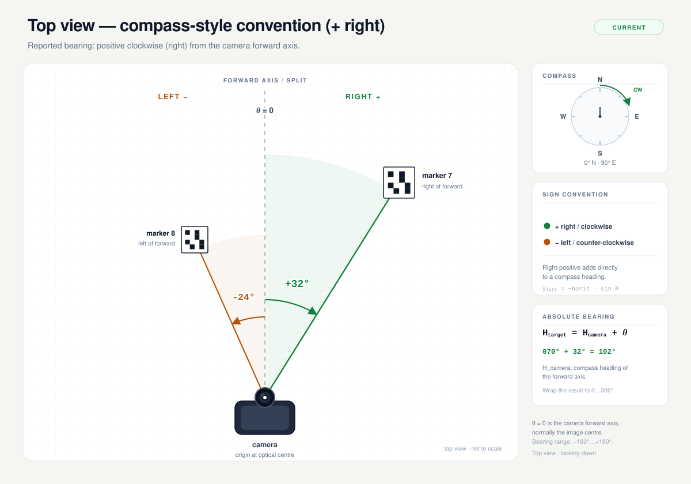
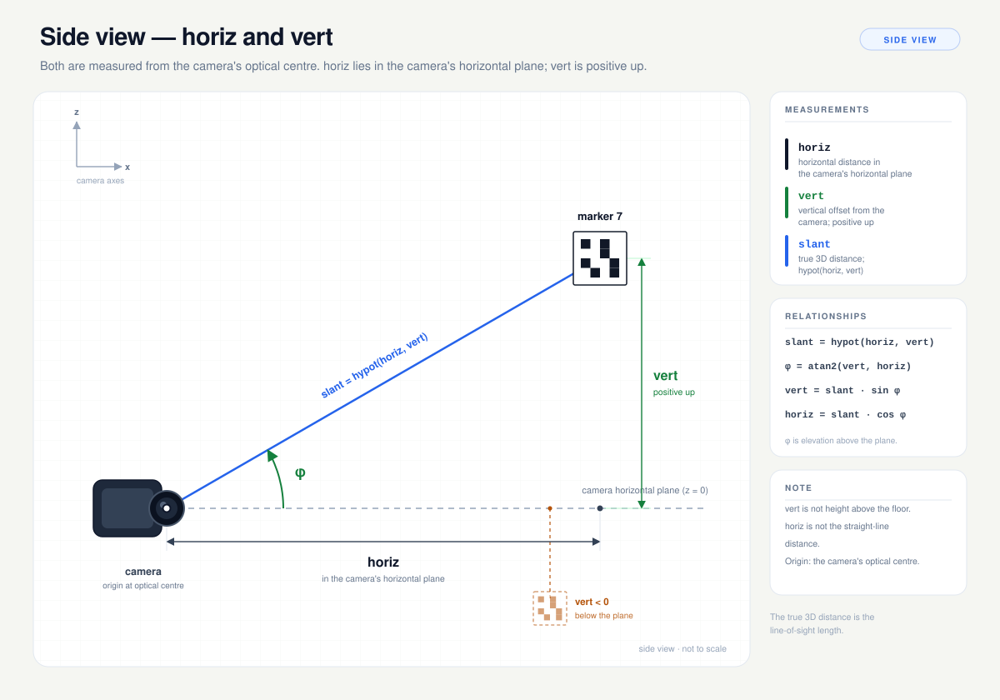

# Bearing Geometry

These are the full camera-relative geometry diagrams.  The project
[README](../README.md) uses the [compact two-panel summary](bearing-compact.svg)
at the top; the full top and side views are below.  They are explanatory, not to
scale.

`bearing` is the reported horizontal angle (yaw); the side view also shows the
derived vertical angle `φ` (elevation).

## Top View — Compass-Style Convention (+ Right)



This is the current reported convention.  Right is positive, left is negative,
and the angle is measured clockwise from the camera's forward axis (looking
down).  It composes directly with the router's compass heading:

```text
H_target = H_camera + bearing
```

`H_camera` is the compass heading of the camera's forward axis, including any
mounting yaw.  For a rigid forward-facing camera it is simply the robot's
heading.

The body frame stays right-handed (`x` forward, `y` left, `z` up), so when
reconstructing a marker position with a right-positive bearing:

```text
x       = horiz * cos(bearing)
y_left  = -horiz * sin(bearing)
z       = vert
```

Earlier builds reported the opposite sign (positive left).  If you are parsing
old output, use `H_target = H_camera - bearing`.

## Side View — `horiz` and `vert`



`horiz` is the planar distance in the camera's horizontal plane.  `vert` is the
perpendicular offset from that plane, positive up.  Neither is height above the
floor, and `horiz` is not the straight-line distance.

```text
slant = hypot(horiz, vert)
φ     = atan2(vert, horiz)
vert  = slant * sin(φ)
horiz = slant * cos(φ)
```

`φ` is the elevation angle above the camera's horizontal plane.

## Internal Body-Frame Angle (+ Left)

The detector still solves in the right-handed body frame:
`bearing_rad = atan2(y_left, x_forward)`, positive counter-clockwise.
`src/output.cpp` negates it at the output boundary, so this is **not** the
`bearing` value in the JSON or text output.

Compass heading from the internal body-frame angle:

```text
H_target = H_camera - bearing_rad
```

## Why + Right

The router's `MotionDirector` already works in compass headings (clockwise from
north), so a right-positive camera bearing avoids a sign flip at every call
site.  Keeping the body frame right-handed means only the reported sign changes;
the PnP math does not.  The negation lives in `reportedBearingDeg()` in
`src/output.cpp`, so both JSON and text output use it.

## Regenerating

```bash
python3 docs/gen_bearing_diagrams.py
```

This writes the full top view, the side view, and the compact summary.  It needs
no third-party packages.  The PNG previews in this directory were rendered at
2× with headless Chrome.
